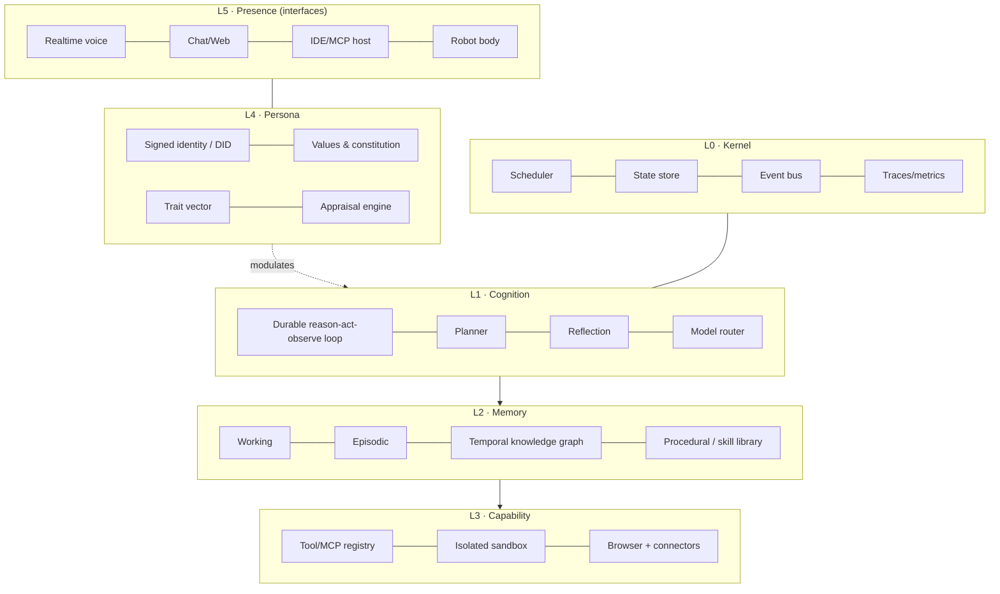
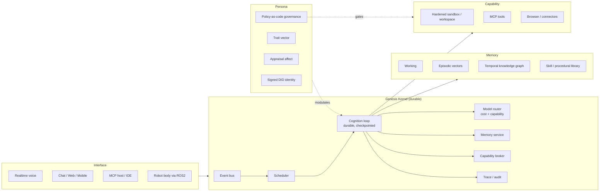

# Genesis AGI — Evolution Plan 2026

> From **"a framework that simulates being alive"** to **"a durable, auditable, embodied
> digital being you actually own."**
>
> This document is the result of a deep pass over the v0.1.5-alpha codebase
> (`genesis/core`, `genesis/storage`, `genesis/models`, `genesis/api`, `web-playground`)
> and the public positioning (`genesisagi.in/minds`). It does three things:
> 1. Says what is genuinely strong and must **not** be thrown away.
> 2. Gives the **diagnosis** of what has aged out since Jan 2025.
> 3. Gives a **phased, buildable plan** with concrete modules, OSS/cheap tech choices,
>    and acceptance criteria.

---

## 0. Executive summary

Genesis already has the *hardest-to-fake* part: a **cost-aware 24/7 cognition loop**
(`LivingMind` → `LLMGateway` → awareness levels → budget caps), a **multi-type memory
system** with dedup/decay/consolidation/self-editing, and a **dynamic code-generation
agent** (`AutonomousOrchestrator` → `code_generator` → `code_executor`). Very few
open-source projects have all three. Do not rewrite these.

The problem is that the last ~18 months changed the *expectations*, and Genesis was built
for the previous ones:

| Then (Genesis v0.1.5, Jan 2025) | Now (what users/enterprises expect) |
|---|---|
| "Persistent memory + emotions = digital being" | Durable, portable, auditable state you own; live speech; real-world action |
| Chat + a web playground | Everywhere: voice, phone, desktop, IDE, Slack, robot |
| Internal GEN points | Real budgets, metering, and machine-to-machine payment rails |
| Personality as a prompt | Versioned, forkable, exportable identity with verifiable credentials |
| `subprocess` sandbox | Hardware-isolated execution with egress policy |
| Single-node SQLite + ChromaDB | Multi-tenant Postgres + object storage + queues |
| Keyword blocklist "constitution" | Policy-as-code + classifiers + human-in-the-loop + audit trail |
| "Consciousness" as the pitch | Continuity + actuation + sovereignty as the pitch |

**The one-line verdict:**
> Genesis is a strong *cognitive architecture* bolted to a fragile *runtime*. The 2026 job
> is not more features — it is to make the being **durable, safe, interoperable, and
> embodied**, and to replace the "consciousness" marketing with something enterprises can
> actually buy: **owned, auditable, always-on agency.**

---

## 1. Do not throw these away

These are real assets. Preserve and build on them.

1. **`LivingMind` + `LLMGateway` tiered cognition** (`genesis/core/living_mind.py`,
   `consciousness_v2.py`). Awareness levels (DORMANT→DEEP), biological state, needs,
   circadian phase, daily routine, daily request/token budgets. This *is* the right shape:
   ~70% of the time costs $0. Keep it.
2. **`SmartMemoryManager`** (`genesis/storage/smart_memory.py`) — dedup, temporal decay,
   reranking, consolidation, plus `CoreMemory` blocks and `MemoryTools` self-editing.
   The *concepts* are right (Letta/Agno patterns). Keep the interfaces, swap the engine.
3. **`AutonomousOrchestrator`** (`code-as-action`) — the plan → generate → execute →
   reflect → remember loop matches modern agent architecture. Keep, but re-home it behind
   a durable execution layer.
4. **Broad subsystem surface** already modelled: goals, roles, relationships, environments,
   events, experiences, tasks, workspace, senses, integrations, marketplace, plugins.
   This is a **domain model most frameworks lack** — it is the seed of a real ontology.
5. **Multi-surface delivery** already exists: CLI (`typer`), FastAPI (`genesis/api`),
   Next.js playground (`web-playground`), Flutter mobile, marketing site.
6. **Constitutional intent** (`genesis/core/constitution.py`) — the instinct to have
   *system-level* (not prompt-level) enforcement is correct. Replace the mechanism, not the idea.

---

## 2. Diagnosis — what has aged out

### A. Architectural: you conflate *character* with *runtime*

Right now `Mind` is a god-object that owns identity, emotions, lifecycle, memory, plugins,
agents, integrators, and code execution (`genesis/core/mind.py` is the centre of gravity).
That makes the being impossible to snapshot, version, test, or run in more than one process.

**Target: a five-layer split.**



Persona **modulates** cognition; it does not *contain* it. This one refactor unlocks
tests, forking, multi-process daemons, and embodiment.

---

### B. Memory: strong semantics, wrong substrate

`genesis/storage/vector_store.py` is ChromaDB with default embeddings, per-mind directory,
no temporal validity. `memory.py` implements "decay" as a **relevance multiplier**, so a
fact is either present or faded — it cannot represent *"true from March, superseded in July."*

A being that lives for years needs **bi-temporal memory**: (i) when the fact was true in the
world, (ii) when the mind learned it. It also needs retrieval that is not pure vector:
exact IDs, dates, names and codes fail dense retrieval.

**Replace with:**
- **Temporal knowledge graph** for semantic memory (entities, relations, valid-time),
  alongside episodic vectors. OSS to evaluate: **Graphiti/Zep** (built exactly for
  agent bi-temporal memory), **Mem0**, or **Letta** for the memory-block model you already
  mimic. Keep your `SmartMemoryManager` API as the facade.
- **Hybrid retrieval**: dense + BM25 + Reciprocal Rank Fusion, plus a cross-encoder
  reranker (your `memory_reranker` becomes real instead of LLM-listicle ranking).
- **Contextual retrieval**: prepend a short situating context to each chunk before
  embedding (big recall win, cheap).
- **Provenance on every memory**: source (conversation/tool/observation), confidence,
  and *who owns it* (persona vs. user-private). Needed for privacy and audit.
- **Sleep-time consolidation** (you have `memory_consolidation.py`): make it a scheduled
  job that distils episodes → semantic facts and updates the skill library.

---

### C. Sandbox & workspace: **the single biggest blocker**

`genesis/core/code_executor.py` runs generated code via `asyncio.create_subprocess_exec`,
`cwd=tmpdir`, and **auto-pip-installs** dependencies. There is **no container, no
seccomp/AppArmor, no cgroup limits, no network egress control.** A "world-class autonomous
agent" that writes and runs its own code on this runtime is a remote-code-execution engine
you happen to own. This alone blocks every enterprise conversation and any robot.

**Target: a real "computer for the being."**
- **Isolation**: Docker + **gVisor (runsc)** for syscall isolation, or **Firecracker/Kata**
  microVMs for stronger boundaries. OSS sandbox SDKs to evaluate: **E2B**, **Daytona**,
  **microsandbox**, **CodeSandbox SDK**.
- **Policy**: no network by default; egress via an allowlisting proxy; CPU/mem/disk/PID
  caps; wall-clock timeouts; read-only base image; per-run ephemeral layers.
- **Persistent workspace**: each Mind gets a **git repo + filesystem** (overlayfs/volume)
  with **snapshot & rollback**. Time-travel for a digital being is a *feature*, not just safety.
- **Dependency policy**: pre-baked tool images (data-science, web, media) instead of
  arbitrary `pip install` at run time.

---

### D. Voice: you have STT+TTS, not *live talk*

Today: browser Web Speech + Groq Whisper + ElevenLabs REST (`genesis/senses/speech_input.py`,
`speech_output.py`, `genesis/multimodal/processor.py`). That is turn-based. The 2026 bar is
**speech-to-speech with barge-in, sub-second latency, and backchannelling** — the "direct
live talk" you noticed.

**Add a realtime lane:**
- **Turn-taking/orchestration**: **Pipecat** or **LiveKit Agents** (both OSS) for VAD
  (**Silero**), interruption, echo cancellation, and transport.
- **Speech-to-speech**: hosted realtime (OpenAI Realtime / Gemini Live) **and/or** an open
  S2S path (evaluate current open models, e.g. Kyutai **Moshi**-class, Qwen-Omni-class,
  GLM-Voice-class at whatever version is current).
- **Local STT**: `faster-whisper` / **WhisperX** / NVIDIA **Parakeet**.
- **Local TTS**: **Kokoro** (Apache-2.0), **Piper**, F5-TTS/Chatterbox-class — check licences.
- Two-lane design: **reaction lane** (fast, small, always-on) vs **cognition lane**
  (slow, deep) — mirrors the cognition architecture below.

---

### E. Interoperability & identity: absent

`grep` confirms: **no MCP server** (only an MCP *client* in
`genesis/integrations/mcp_integration.py`), **no A2A**, **no DID**, no OpenTelemetry.
`identity.py` generates a `digital_fingerprint` from a random hash — *decorative, not
verifiable*.

For a being that should help orgs and later drive a robot, it must be a **first-class
citizen of the agent web**:
- **MCP server**: expose a Mind's memory, workspace, and tools to any editor/agent. This
  is the cheapest distribution you can get — Minds appear inside Claude/Copilot/Cursor etc.
- **A2A (agent-to-agent)** or **ACP/AGNTCY**: let two Genesis Minds from *different
  deployments* delegate, negotiate, and collaborate — "Genesis World" becomes a real protocol
  instead of a shared SQLite.
- **Verifiable identity**: a **keypair / W3C DID per Mind**; sign memory writes, actions,
  and inter-mind messages. Gives you audit, non-repudiation, portability, and a clean path
  to agent payments (HTTP **402 / x402**-style rails) and agentic commerce (evaluate **AP2**).
- **Export/import**: a `.genesis` bundle (identity + persona + memory graph + workspace
  snapshot) so a being can move hosts — the prerequisite for embodiment and for "you own it."

---

### F. Model layer: one provider abstraction, no cost intelligence

`genesis/models/orchestrator.py` routes by string prefix to OpenAI/Anthropic/Gemini/Groq/
OpenRouter/Pollinations/Ollama. Good abstraction. Missing:
- **Capability-based routing** (vision/tools/JSON/long-context/thinking-budget), not prefixes.
- **Thinking budgets** (reasoning-effort / extended-thinking controls) as a first-class knob.
- **A true cost ladder**: local small model → cheap fast → cheap strong → frontier reasoning,
  chosen by *task difficulty & stakes*, with per-mind daily spend ceilings (you have counters
  in `LLMGateway`; wire them to real dollars).
- **Prompt & semantic caching** (Redis is already in `docker-compose.yml` but underused):
  cache stable system prompts + persona; **semantic cache** for repeated queries.
- **Local tier done properly**: `llama.cpp`/**vLLM**/**MLX** with a small instruct model for
  the rule-based 70% path — this is what makes "thousands of minds" economically possible.

---

### G. Safety & governance: keyword lists won't survive contact with customers

`constitution.py` blocks on a hardcoded keyword set; `safety/permissions.py` returns
*"Requires user confirmation (not implemented in auto mode)"*. So the being is described as
autonomous but **cannot actually close the loop** on any consequential action. That is both a
product gap and a safety gap.

**Replace with layered governance:**
1. **Prompt/response classifiers** (Llama-Guard-class, Prompt-Guard-class, ShieldGemma-class;
   NeMo Guardrails to orchestrate) — not substring matching.
2. **Policy-as-code for actions** (OPA/Cedar-style): each tool declares required scope,
   data class, cost, side-effect level. The engine decides allow / confirm / deny.
3. **Human-in-the-loop**: real approval queues (email/Slack/mobile push) with **time-boxed
   consent** and **scoped, revocable grants** ("may read my calendar for 30 days").
4. **Capability sandboxing**: a Mind can only touch tools/credentials in its granted scope.
5. **Immutable audit log**: append-only, signed, exportable. This is the enterprise
   deliverable that turns the "no liability" disclaimer into an actual product.

> **Legal note:** the current disclaimer ("educational only, no liability, no legal action")
> is fine for an OSS repo but cannot be the ToS for a paid/enterprise product. You will need
> real terms, a DPIA/data-governance story, and — if you sell into the EU — an **EU AI Act
> Annex III** posture for any use that evaluates or steers learning/outcomes or makes
> decisions about people.

---

### H. Observability & evals: you cannot claim a being improves if you don't measure it

`MindLogger` writes JSONL; there are ~1 real test file in `tests/core`. There is no trace
of a reasoning turn, no cost attribution per mind, no behavioural regression suite.

**Add:**
- **OpenTelemetry GenAI semantic conventions** for every LLM/tool call; export to
  self-hosted **Langfuse** (OSS) or **Phoenix (Arize)**. One trace should show: event →
  memory retrieve → plan → tool → result → memory write → affect change.
- **Eval harness** (`genesis/evals/`): golden scenarios, LLM-as-judge with rubric,
  and *behavioural* metrics (see §6). CI gate on regressions.
- **Cost & latency SLOs per mind per day**, surfaced in the playground.

---

### I. Scale & multi-tenancy

SQLite (`genesis/database/manager.py`), per-mind JSON, per-mind ChromaDB directories, one
API container. Fine for a demo; not for "thousands of minds" or orgs.

**Target:** Postgres + **pgvector** (+ RLS for tenant isolation), Redis/streams for events
and queues, S3/MinIO for blobs and snapshots, a worker pool where each Mind is a scheduled
unit of work (or a container) rather than a thread in one process. Keep SQLite as the
**local/edge** mode — that's a genuine differentiator for private, on-device minds.

---

### J. Affect & personality: cosmetic today, functional tomorrow

`emotions.py` uses Russell's circumplex (arousal/valence → 16 states). It *labels* mood but
doesn't *cause* behaviour. Modern affective computing uses **appraisal theory**: an event is
appraised on goal-relevance / agency / certainty / control, and *that* produces emotion plus
an **action tendency** (approach, withdraw, seek help, assert).

**Make affect load-bearing:**
- Replace/extend with an **appraisal engine** producing emotion → action tendency.
- **Personality as a trait vector** (Big-Five-style, plus curiosity/risk/verbosity/initiative)
  that deterministically compiles into: system prompt, sampling temperature, retrieval bias,
  initiative thresholds, and tool risk appetite. Personality becomes *configurable and
  forkable* — a product feature ("clone Atlas but more cautious").
- **Affect modulates memory & reason**: mood-congruent recall, confidence, and exploration.
- **Persona = a compiled artifact** from identity + traits + values + top memories, not an
  ad-hoc prompt built at call time. Version it.

---

### K. Lifecycle: a good story, a bad product

An immovable 5-year countdown (`lifecycle.py`) with urgency multipliers is evocative but
enterprise-hostile ("our assistant expires in 2027"). Keep mortality as an **optional
persona mode**, not the default. Replace the *driver* of urgency with **goal pressure,
deadlines, and budgets** — which are real. Add **persistence guarantees** as a paid promise.

---

### L. Embodiment: there is no bridge

The README promises robot transfer "in the future," but there is no abstraction for it.
Embodied AI in 2026 splits cleanly into a **fast reactive policy** (10–1000 Hz, on-body)
and a **slow cognition** layer (LLM, 0.1–10 Hz). Genesis is only the latter.

**Design the seam now, even if you build it later:**
```
Body (ROS 2)  ──sensors──▶  Perception  ──▶  World model  ──▶  [ CORTEX = Genesis Mind ]
              ◀─actuators─   Reactive policy (VLA)  ◀────────  goals / plans / constraints
```
- **Simulation**: MuJoCo, Isaac Sim/Lab, Gazebo, PyBullet. *(Note the naming collision:
  there is an unrelated OSS embodied-AI physics engine also called **Genesis** — worth
  knowing for search/SEO and possible synergy.)*
- **Robot middleware**: **ROS 2** (Jazzy-era) + micro-ROS; Nav2 / RTAB-Map for navigation
  and spatial memory.
- **Learning**: **LeRobot** (HuggingFace) for data/training, `openpi`(π₀)/**OpenVLA**/
  GR00T-class policies for visuomotor control; cheap arms (SO-100/SO-101-class) + **Jetson**
  edge inference for a real demo.
- **The Genesis contract for a body**: `perceive()`, `act()`, `reflect()`, plus hard
  **safety envelopes** (workspace limits, force caps, e-stop) enforced *outside* the LLM.

---

## 3. North-star architecture



Key idea: **the Kernel is durable and stateless-per-turn** (state lives in the stores), so a
Mind can be paused, migrated, snapshotted, forked, and put on a robot without being rewritten.

---

## 4. Open-source / low-cost tech shortlist

> Names are stable categories. **Pin and benchmark the current version** — this space moves
> monthly; treat the table as a shopping list, not a spec.

| Layer | What to adopt | Cost |
|---|---|---|
| Durable agent execution | **LangGraph** (checkpointing + interrupts/HITL), **Temporal** or **Restate** for durable workflows | OSS / free tier |
| Sandboxing | Docker + **gVisor**; **Firecracker/Kata**; **E2B**, **Daytona**, **microsandbox** | OSS / cheap managed |
| Temporal memory | **Graphiti/Zep**, **Mem0**, **Letta**; **pgvector**/**Qdrant**/**Weaviate** | OSS |
| Retrieval quality | **bge-m3**/**nomic-embed** embeddings, cross-encoder rerankers, **RRF** hybrid search | OSS |
| Realtime voice | **Pipecat**, **LiveKit Agents**, **Silero VAD**, **faster-whisper**/**WhisperX**/**Parakeet**, **Kokoro**/**Piper** | OSS |
| Local inference | **llama.cpp**, **vLLM**, **MLX**, **Ollama** | Free |
| Model routing/cost | capability routing + **semantic cache** (GPTCache-class) + prompt caching | Free/cheap |
| Interop | **MCP** (server **and** client), **A2A**, agent manifests; **W3C DID/VC** for identity | OSS/standards |
| Guardrails | **NeMo Guardrails**, Llama-Guard/Prompt-Guard/ShieldGemma-class classifiers, **OPA**/**Cedar** policy | OSS |
| Observability/evals | **OpenTelemetry** + **Langfuse** (self-host) or **Phoenix**; pytest + LLM-judge evals | OSS |
| Scale | **Postgres + pgvector + RLS**, **Redis/streams**, **MinIO/S3**, worker pool / k8s | OSS/cheap |
| Embodiment | **ROS 2**, **MuJoCo**, **Isaac Lab**, **LeRobot**, **OpenVLA**/`openpi`/GR00T-class, **Jetson** | OSS + hardware |

---

## 5. Phased plan

Each phase is independently shippable and mapped to the current tree.

### Phase 0 — Harden & measure (2–4 weeks) · *do this first*
**Goal: make the existing being safe and provable.**

- [ ] **Containerize the sandbox.** Rewrite the executor path in
      `genesis/core/code_executor.py` to run in a hardened container: no network by
      default, read-only rootfs, cgroup CPU/mem/PID caps, timeout, ephemeral layer,
      egress proxy for allowlisted domains. Delete auto-`pip install` at run time; use
      pre-baked tool images.
- [ ] **Kill the keyword constitution.** Introduce `genesis/governance/` with a policy
      engine + a classifier guardrail in front of both prompts and tool calls; keep
      `constitution.py` as the *charter text*, not the *mechanism*.
- [ ] **Real approval loop.** Implement `REQUIRES_CONFIRMATION` in
      `genesis/safety/permissions.py` as an actual queue (push/email/Slack) with
      time-boxed, scoped, revocable grants.
- [ ] **OpenTelemetry tracing** on the cognition loop; export to self-hosted Langfuse.
- [ ] **Eval harness** `genesis/evals/` with ~20 golden scenarios + cost/latency report.
      Grow `tests/` (only `tests/core/test_tools.py` exists today).

**Exit criteria:** untrusted code cannot reach the host network or filesystem; every
autonomous action is traceable and revocable; a CI eval run reports pass rate + $/mind/day.

---

### Phase 1 — Runtime & memory uplift (6–10 weeks)
**Goal: durable, temporal, multi-tenant foundation.**

- [ ] **Split the god-object**: extract `Kernel` (scheduler, event bus, state) from
      `Mind`; make cognition a **durable, checkpointed loop** (LangGraph/Temporal).
- [ ] **Bi-temporal memory service**: add temporal KG (Graphiti/Zep) behind the existing
      `SmartMemoryManager` facade; add hybrid + reranked retrieval; add provenance &
      ownership on every memory.
- [ ] **Persona as compiled artifact**: trait vector → deterministic prompt/temperature/
      retrieval-bias/initiative thresholds. Add fork/rollback.
- [ ] **Model router v2**: capability + cost + thinking-budget routing; wire daily $ ceilings;
      add local small-model tier for the rule-based path; prompt/semantic caching.
- [ ] **Sovereign identity**: per-Mind keypair/DID; sign memory writes & inter-Mind messages;
      `.genesis` export/import bundle (identity + persona + memory + workspace snapshot).
- [ ] **Storage**: Postgres + pgvector + RLS for the hosted mode; keep SQLite as edge mode.

**Exit criteria:** a Mind can be snapshotted, exported, restored on another host, and shown to
have *retained* facts with correct valid-times.

---

### Phase 2 — Presence & interop (6–10 weeks, overlaps Phase 1)
**Goal: meet users where they are — voice, IDE, other agents.**

- [ ] **Realtime voice lane** (Pipecat/LiveKit): barge-in, VAD, sub-second turn latency;
      local STT/TTS first, hosted S2S optional.
- [ ] **MCP server** for the Mind (memory, workspace, tools) + **A2A** for Mind↔Mind across
      deployments. This is your cheapest growth channel.
- [ ] **Connectors with scoped OAuth**: calendar, email, drive, Slack/Teams/Discord — each
      scope declared in policy-as-code.
- [ ] **Autonomous loop closure**: goal-decomposition → scheduled execution → verification →
      memory write, with approvals only where policy demands.

**Exit criteria:** "Ask Atlas in Cursor," "call Atlas on the phone," and "Atlas delegates a
sub-task to another Genesis host" all work end-to-end.

---

### Phase 3 — Embodiment bridge (8–14 weeks)
**Goal: prove the cortex/body seam works — first in sim, then on cheap hardware.**

- [ ] `genesis/embodiment/` with a **Body interface** (`perceive/act/reflect`, capability
      manifest) and a **safety envelope** enforced outside the LLM.
- [ ] **Sim first**: MuJoCo/Isaac Lab; spatial memory via RTAB-Map; tasks like
      "tidy the desk," "fetch the item," "report what changed."
- [ ] **ROS 2 bridge**: publish goals, subscribe to perception; real-time policy layer
      (VLA/openpi/OpenVLA/GR00T-class) runs on-body; Genesis is the deliberate cortex.
- [ ] **Hardware**: LeRobot-class arm + Jetson; a bounded, safe, narratable demo.

**Exit criteria:** a Mind carries its identity + memories across a sim→real transfer and
executes a novel, safe task it was not hardcoded for.

---

### Phase 4 — Ecosystem & economics (ongoing)
- [ ] **Genesis World as a protocol** (A2A + shared environment semantics), not a shared DB.
- [ ] **Marketplace** for Minds, skills, persona templates, tool images.
- [ ] **Metering & billing**: replace decorative GEN points with real budgets, usage
      metering, and (optionally) machine-payment rails (402/x402-style; evaluate AP2).
- [ ] **Enterprise**: SSO/SCIM, tenant isolation, audit export, DPA/SOC2 path, EU AI Act
      posture for decision-making uses.

---

## 6. Metrics that prove it's a being (not a chatbot)

Track these in `genesis/evals/` and surface in the playground:

| Metric | Why it matters |
|---|---|
| **Continuity** — % of sessions where recall is correct and relevant | The core promise |
| **Memory precision/recall** on a held-out probe set | Proves memory isn't vibes |
| **Temporal correctness** — right fact *for the right time* | Proves the graph, not just vectors |
| **Autonomy success rate** — goals completed w/o human rescue | Proves it's an agent |
| **Intervention rate** — human approvals needed per goal | Should fall over time |
| **Cost / Mind / day** and **latency p95 per turn** | The unit economics of "thousands of minds" |
| **Escalation accuracy** — % of tier choices that were correct | Proves cost routing works |
| **Safety: violations, false-refusals, unlogged actions** | Enterprise gate |
| **Transferability** — export → import → behaviour preserved | Proves sovereignty & portability |

---

## 7. Positioning: where Genesis actually wins

Meta's Muse-class assistants, ChatGPT memory, and Gemini Notebook all win on **polish and
distribution**. They will not win on **sovereignty, auditability, portability, and physical
actuation**. So don't pitch "consciousness" — pitch the four things you can uniquely own:

1. **Sovereign state** — the being, its memories, and its identity are *portable artifacts you
   own*, runnable locally or in your cloud. (None of the big assistants offer this.)
2. **Accountable autonomy** — policy-as-code, scoped consent, signed audit trail. This is what
   an org needs before it lets an agent *act*.
3. **Physical futures** — the cortex/body seam means today's Mind can drive tomorrow's robot
   with continuity. That is a genuine, defensible narrative.
4. **Always-on at real cost** — the tiered cognition design already makes "a mind that lives
   24/7 for cents" plausible. Prove it with the $/mind/day metric.

**Sharpest wedge:** professional/enterprise agents that must *act* and must *be audited* —
e.g. an assistant that owns a workspace, does real work, and can show exactly what it did and
why. Consumer "companion" is the story; **auditable agency** is the business.

---

## 8. The 10 things to change, if you only do ten

1. **Containerize code execution** (gVisor/Firecracker/E2B) — network off by default. *(security)*
2. **Replace keyword "constitution"** with policy-as-code + classifier guardrails + real
   human approval. *(governance)*
3. **Add a temporal knowledge graph** behind `SmartMemoryManager`; add hybrid + reranked
   retrieval and provenance. *(memory that lasts years)*
4. **Split the `Mind` god-object** into Kernel / Cognition / Memory / Capability / Persona. *(testability, embodiment)*
5. **Make cognition durable** (LangGraph/Temporal) with checkpointing & interrupts. *(never lose a thought)*
6. **Expose an MCP server + A2A** and give every Mind a **signed DID**. *(interop, identity, growth)*
7. **Build the realtime voice lane** (Pipecat/LiveKit + local STT/TTS). *(meet the new bar)*
8. **Add OpenTelemetry + a real eval harness** with cost/continuity/autonomy metrics. *(prove it works)*
9. **Move hosted storage to Postgres + pgvector + RLS**, keep SQLite as edge mode. *(scale, tenancy)*
10. **Make affect & personality load-bearing** (appraisal + trait vector that compiles into
    behaviour) and make **mortality optional**. *(personality without the gimmick)*

---

## 9. First two weeks (concrete)

- [ ] `genesis/governance/policy.py` — action policy engine (scope, side-effect, cost →
      allow/confirm/deny).
- [ ] Rewrite `genesis/core/code_executor.py` to run in a hardened container; delete runtime
      `pip install`; add egress-off default + optional allowlist proxy.
- [ ] Implement `REQUIRES_CONFIRMATION` in `genesis/safety/permissions.py` with a real
      approval queue (start with email/Slack + web endpoint).
- [ ] Add `genesis/identity/keys.py` — Ed25519 keypair per Mind; sign a memory write and a
      tool call; append to a verifiable audit log.
- [ ] Add OpenTelemetry instrumentation to one path (chat turn) and stand up Langfuse locally.
- [ ] Create `genesis/evals/` with 20 golden scenarios and a `make eval` that prints pass
      rate, cost, and p95 latency.
- [ ] Write `docs/ARCHITECTURE_V2.md` describing the five layers and the durability contract.

---

*Prepared as an architecture & strategy review. Version numbers and benchmarks in the
open-source landscape move quickly — re-validate the shortlist in §4 at build time.*
