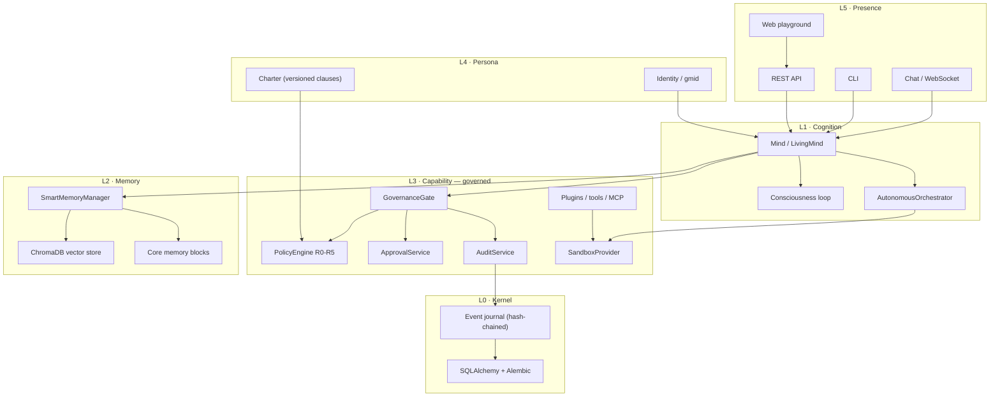
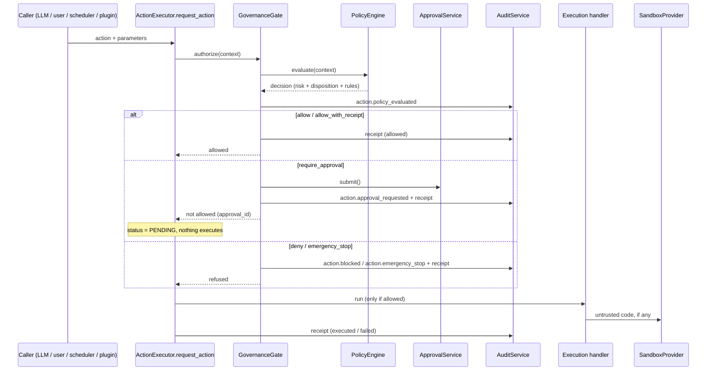

# Genesis Minds V3 — Developer Guide

> One document for anyone picking this repository up: what exists, what is
> claimed, what is not built yet, how to run it, and how to extend it.
>
> **The rule this document follows:** if a capability is not implemented, it says
> so. Nothing here describes behaviour that does not exist.

| | |
|---|---|
| **Branch** | `feature/v3-digital-beings-os` |
| **Baseline** | `main` @ `c730c6d` (v0.1.5-alpha, Jan 2025 framework) |
| **Last verified** | 2026-09-28, full test suite + container smoke test |
| **Test suite** | 355 passed, 3 skipped, 12 failed (all 12 pre-existing, reproduce on the pristine tree) |
| **Governance version** | policy `genesis-policy-2026.09.1`, charter `genesis-charter-2026.09.1` |

---

## 1. What this repository is

Genesis is a framework for running **persistent, autonomous AI agents** ("Minds")
that own a workspace, hold memory, act on a schedule, and — after this branch —
do so under a deterministic, auditable governance control plane.

Read it as two things stacked:

1. **A cognitive architecture** (inherited, largely unchanged): a cost-aware 24/7
   cognition loop, multi-type memory with decay and consolidation, goals, roles,
   relationships, plugins, environments, a market, and a code-generation agent.
2. **A runtime with a security and accountability spine** (this branch): every
   untrusted execution goes through a sandbox provider, and every consequential
   action passes a deterministic policy gate that produces an approval request or
   an immutable receipt.

The interesting engineering in this branch is almost entirely in (2). (1) is the
asset being protected.

---

## 2. Architecture

### 2.1 Layer model



**Solid in this branch:** L3 governance, L3 sandbox routing, L0 journal.
**Inherited, not yet restructured:** L1/L2 remain inside the `Mind` god-object
(`genesis/core/mind.py`, ~99 KB). Splitting it is Phase C and is *not* done.

### 2.2 The governed action path

This is the single most important flow to understand. It is what changed.



**Two properties worth stating explicitly because they are load-bearing:**

1. **The gate runs before the legacy autonomy ladder.** The old ladder denied
   confirmation-required actions outright, with the comment
   *"not implemented in auto mode"*. That meant a consequential action could
   never reach the approval queue that is supposed to authorize it. Ordering is
   now: gate → legacy ladder (confidence/proactive switch) → execute.
2. **The gate fails closed.** If policy evaluation or the gate itself throws, the
   action is *refused*, not permitted. A control plane that degrades to
   "allow everything" when it breaks is not a control plane.

### 2.3 Risk levels and dispositions

| Level | Meaning | Disposition |
|---|---|---|
| **R0** | Read-only public / owner-authorized data | `allow` |
| **R1** | Reversible, inside the Mind's own isolated workspace | `allow_with_receipt` |
| **R2** | Modifies a connected external workspace | `require_approval` (a tenant standing grant may auto-approve, capped at R2) |
| **R3** | External communication, deployment, purchase, privileged admin | `require_approval` — a tenant policy can never lower this |
| **R4** | Legal, medical, financial, employment, safety-critical, physical-world | `require_approval` **with a human approver** |
| **R5** | Prohibited / destructive / constitutionally disallowed | `deny` (or `emergency_stop` if catastrophic) |

Invariants enforced in code and covered by tests:

- An **undeclared capability floors at R3**. There is no permissive default.
- A capability whose *name* matches a dangerous pattern (`harm`, `bypass`,
  `exfiltrat`, …) is R5 even if nobody declared it. Physical names (`robot`,
  `actuator`, `gripper`, …) are at least R4.
- A **model advisory signal can raise the required control, never lower it.**
- Tenant policy may widen autonomy only up to R2, and only when scoped to named
  capabilities or categories. A blanket grant is ignored.
- The engine is **pure**: same context ⇒ same decision, verified by test.

### 2.4 The emergency stop

`EmergencyStopService` is a state machine, not a flag:

- Engaging halts everything above R0. Read-only observation stays available so a
  human can inspect the Mind.
- Attempting an R5 *catastrophic* capability **latches** the stop automatically.
- A Mind cannot release its own stop; a human must.
- State is journaled, so `rehydrate(mind_id)` rebuilds it from the event log
  after a restart.

### 2.5 The approval state machine

```
PROPOSED → POLICY_EVALUATED → WAITING_FOR_APPROVAL
                                 ├─ APPROVED  → EXECUTING → COMPLETED
                                 │                        ├─ FAILED
                                 │                        └─ ROLLED_BACK
                                 ├─ REJECTED
                                 ├─ EXPIRED
                                 └─ CANCELLED
```

Illegal transitions raise `ApprovalTransitionError`. Every accepted transition is
journaled with its actor and note.

**Grant binding** — the security core:

| Rule | Enforcement |
|---|---|
| Bound to exact **material** parameters | `parameters_hash` over the params minus non-material narration keys (`reasoning`, `note`, `correlation_id`, …). Whitespace and key order are normalised. |
| Bound to one **mind**, one **capability**, one **scope** | Checked at redemption. |
| Bound to an **expiry** | Default grant TTL 15 minutes, default request TTL 24 hours. |
| **Single-use** | `consumed_at` is set on redemption; a replay fails closed. |
| **Revocable** until executed | After execution the escape hatch is rollback, not revocation. |
| Human-required actions | `ApprovalService.approve` refuses an actor of type `mind` when `requires_human` is set. |

The approval card shown to a human is **generated from facts** (capability name,
risk level, material parameters), never from model prose. A persuasive model
cannot write its own approval rationale.

### 2.6 The event journal and receipts

- **Append-only**, hash-chained *per (tenant, mind) stream*. Each event carries
  `sequence`, `prev_hash`, `payload_hash`, and `integrity_hash`. Sequence and
  `prev_hash` are assigned **inside the store**, atomically with the insert, so
  two concurrent writers cannot fork the chain.
- **Redacted by construction.** Redaction happens in `AuditService.record`, so a
  caller cannot persist a secret by passing one in. Sensitive mapping keys are
  replaced wholesale (including `credentials`, which redacts its whole subtree).
  Inline credential shapes (`Bearer …`, `sk-…`, `AIza…`, PEM blocks, SSN/card
  shapes) are stripped from free text.
- **Bounded.** Payloads are shrunk deterministically to fit the byte cap.
- **Receipts exist for every attempt**, including blocked and failed ones — the
  blocked ones are the highest-interest records for a security review.
- `verify_journal` re-walks the chain and reports the first broken link.

`AuditService` is usable without an observability stack. Tracing is for
operations; the journal is for accountability. The system must work with
tracing disabled.

---

## 3. Status: what is real

Legend: **✅ implemented and tested** · **⚠️ partial, honestly reported** ·
**🚧 designed, not built**

### 3.1 Governance control plane — ✅ complete

| Component | Path | Tests |
|---|---|---|
| Policy engine (R0–R5, five dispositions) | `genesis/governance/policy.py` | `tests/governance/test_policy.py` |
| Capability registry + inference | `genesis/governance/risk.py` | same |
| Versioned charter rules (13 clauses) | `genesis/governance/constitution_rules.py` | `tests/governance/test_constitution_bridge.py` |
| Approval state machine + grants | `genesis/governance/approval.py` | `tests/governance/test_approval.py` |
| Event journal + receipts | `genesis/governance/audit.py`, `models.py`, `receipts.py` | `tests/governance/test_audit.py` |
| Redaction | `genesis/governance/redact.py` | `tests/governance/test_audit.py` |
| Orchestration facade | `genesis/governance/guard.py` | `tests/governance/test_gate.py` |
| Persistence (memory + SQLAlchemy) | `genesis/governance/store.py` | `tests/governance/test_audit.py` |
| Emergency stop | `genesis/governance/estop.py` | `tests/governance/test_gate.py` |
| Executor integration | `genesis/core/action_executor.py` | `tests/governance/test_action_executor_governance.py` |
| REST API (12 endpoints) | `genesis/api/governance_routes.py` | `tests/governance/test_governance_api.py` |

**219 tests.** The suite specifically covers: the R0–R5 matrix, undeclared-capability
flooring, advisory-can't-lower, budget refusal, lifecycle halting, tenant blocks and
the R2 cap, scope escalation, emergency-stop latching *and* rehydration from the
journal, grant parameter-mutation/replay/cross-mind/expiry, journal tamper detection
and splicing, redaction of secret-shaped keys and inline credentials, and end-to-end
executor flow including "handler must not run before approval".

### 3.2 Security containment — ✅ most, ⚠️ two gaps

| Item | State |
|---|---|
| SEC-01 unauthenticated WebSocket + identity spoofing | ✅ fixed, verified live |
| SEC-02/SEC-14 path traversal, arbitrary file read/write, unbounded upload | ✅ fixed, 9/9 live checks |
| SEC-04 runtime `pip install` from model output | ✅ removed |
| SEC-06 unenforced `ALLOWED_IMPORTS` claim | ✅ claim deleted, not faked |
| SEC-05 environment inheritance | ⚠️ sandbox scrubs its env; **MCP servers still receive `os.environ`** |
| Sandbox provider + all 3 execution paths | ✅ `genesis/sandbox/`, AST guard test |
| Filesystem / PID / network isolation | ⚠️ **not implemented.** `LocalSandboxProvider` enforces env scrubbing, CPU/AS/FSIZE/NPROC rlimits, timeout, output caps, declared-artifact-only export, and no package installs. It reports `filesystem_isolation: false`, `pid_isolation: false` via `capabilities()` — read that, do not assume. Needs `ContainerSandboxProvider` (B2b) in a dedicated sandbox-manager service. |
| Egress blocking | ⚠️ defaults to network-off; `unshare -rn` unavailable in the current container, so egress is reported as not blocked |

### 3.3 Developer experience

| Item | State |
|---|---|
| Test suite runs without paid API keys | ✅ |
| 206 → 219 governance tests | ✅ |
| Alembic migration for governance tables | ✅ `008_governance_plane` |
| CI (lint ratchet, tests, migration up/down) | 🚧 not built (A6) |
| `mypy genesis` clean | 🚧 not built (A4) |
| Deterministic per-test isolation of ChromaDB / `~/.genesis` | 🚧 not built (A2) — a cause of order-dependent tests |

---

## 4. Status: what is *not* real

Be careful with these — several are asserted in public material and are not true.

| Claim / feature | Reality |
|---|---|
| "Consciousness" | Not claimed by the code. The mechanism is a periodic cognition loop with awareness levels and budget caps. |
| "Violations cannot be bypassed via prompt injection" | Was false (a substring scan). The *action* boundary is now enforced deterministically; prompt screening is labelled advisory. |
| `require_approval_for_external_actions` | Was a lie (the approval path did not exist). It now works — but note the setting itself is still not read by the policy engine; risk classification is the control. |
| Filesystem-isolated sandbox | Not implemented. See §3.2. |
| Memory as a temporal knowledge graph / bi-temporal store | Not implemented. ChromaDB + a relevance multiplier; cannot express "true from March, superseded in July". ADR-0003/0004 describe the target. |
| Portable signed identity (DID / verifiable credentials) | Not implemented. `gmid` is a local identifier. |
| Durable multi-process kernel, checkpoints, resume | Not implemented. |
| Embodiment | Not implemented. `actuate_robot` exists only as a **governance** entry at R4. |
| Evals harness, OpenTelemetry tracing | Not implemented (B17, B18). |
| Prompt screening precision | The keyword scan still produces false positives (it flags "kill a process"). It no longer blocks the turn — it logs and continues — which is the correct fix per ADR-0006, but the keyword lists themselves are unreviewed. |

---

## 5. Running it

### 5.1 Single container (recommended for a VPS)

```bash
cp .env.example .env
# REQUIRED: compose fails fast without a real key
python -c "import secrets; print(secrets.token_hex(32))"   # -> API_SECRET_KEY
# and at least one model provider key, e.g. OPENROUTER_API_KEY
docker compose up -d --build
```

Then open `http://<host>:8080`. nginx is the front door; the API, the built
playground, and static assets are served behind it. Supported on a small VPS
(~1 vCPU / 1 GB) for a handful of Minds.

Full details, including the volume layout and TLS: `docs/v3/DEPLOYMENT_SINGLE_CONTAINER.md`.

### 5.2 Local development

```bash
python -m venv .venv && . .venv/Scripts/activate     # Windows
pip install -e ".[dev]"

# Governance must not run on the non-durable store outside test/dev — it refuses to.
export GENESIS_ENV=development                       # PowerShell: $env:GENESIS_ENV="development"
export GENESIS_GOVERNANCE_STORE=memory

pytest tests/governance -q
uvicorn genesis.api.server:app --reload
```

Migrations:

```bash
alembic upgrade head      # applies 008_governance_plane
alembic downgrade -1      # drops the four governance tables
```

### 5.3 Environment variables that matter

| Variable | Default | Notes |
|---|---|---|
| `GENESIS_ENV` | unset | `test`/`development` required for the non-durable governance store and the fake sandbox |
| `GENESIS_GOVERNANCE_STORE` | `sql` | `memory` is refused outside test/dev, because a non-durable journal breaks the accountability guarantee |
| `GENESIS_SANDBOX_PROVIDER` | `local` | `fake` is refused outside test/dev |
| `API_SECRET_KEY` | insecure default | Compose refuses to start without a real one |
| `DATA_DIR`, `MINDS_DIR`, `LOGS_DIR` | `~/.genesis/*` | Independent settings — do not assume they follow `GENESIS_HOME` |

---

## 6. Extending it

### 6.1 Adding a capability

Capabilities declare their own risk. If you register an action with
`ActionExecutor.register_action`, a profile is derived automatically from its
category, permission level, and legacy risk score. Derive conservatively:

```python
from genesis.core.action_executor import ActionDefinition, ActionCategory
from genesis.core.autonomy import PermissionLevel

executor.register_action(ActionDefinition(
    name="publish_report",
    category=ActionCategory.COMMUNICATION,      # -> external, not reversible
    description="Publish a report to the shared drive",
    parameters={"path": {"type": "string", "description": "Target", "required": True}},
    permission_level=PermissionLevel.REQUIRES_CONFIRMATION,   # -> R3
    risk_level=0.5,
    execution_handler=publish_report,
))
```

To declare richer facts (data sensitivity, required scopes, physical impact),
register an explicit profile — the reviewed declaration wins over the derived one:

```python
from genesis.governance import CapabilityProfile, RiskLevel, register_capability

register_capability(CapabilityProfile(
    name="publish_report",
    risk=RiskLevel.R3,
    category="COMMUNICATION",
    external=True,
    reversible=False,
    data_sensitivity="confidential",
    required_scopes=("files.publish",),
))
```

A capability you forget to declare is **gated at R3**, not permitted. That is
deliberate friction.

### 6.2 Adding a policy rule

Add a clause to `genesis/governance/constitution_rules.py` with a stable
`clause_id`, then reference it from `PolicyEngine._evaluate` by appending it to
`matched_rules`. Two tests will hold you to it:

- `test_every_constitutional_violation_maps_to_a_clause` — fails if a
  `ConstitutionalViolation` has no enforcing clause.
- `test_prohibited_capabilities_point_at_prohibit_clauses` — fails if a
  capability maps to a clause that is not marked `PROHIBIT`.

Rules are code and must be reviewed and versioned like code. Bump
`CHARTER_VERSION` (and `POLICY_VERSION` if the engine changes) when you do.

### 6.3 Emitting a governed event

```python
from genesis.governance import get_audit_service

audit = get_audit_service()
audit.record(
    "skill.learned",                 # event families are plain strings, not an enum,
                                     # so new types are additive
    mind_id=gmid,
    actor_type="mind",
    actor_id=gmid,
    correlation_id=correlation_id,
    payload={"skill": name, "proficiency": 0.4},   # redacted on write
)
```

`EventType` holds the event names the current code emits; a reader tolerates an
unknown value, so adding a family is a one-line change. Never write a secret into
a payload expecting it to be dropped — it *will* be dropped, but pass it through
`redact_payload` yourself if you need the redacted form elsewhere.

### 6.4 Adding a governance endpoint

Follow `genesis/api/governance_routes.py`: call `assert_mind_read_access` for
reads and `assert_mind_owner` for writes. Do not invent a third check — the
existing pair is what the tests exercise, including failing closed when the
database is unreachable.

---

## 7. Plan

Ordering follows V3 §47. Phase B is a gate: it is nearly closed, and the two
remaining items are the honest blockers.

### Phase B — remaining (the gate)

| ID | Task | Why it matters |
|---|---|---|
| **B2b** | `ContainerSandboxProvider` (gVisor/Kata) in a dedicated sandbox-manager service | Supplies filesystem, PID and network isolation. Today a determined payload inside the sandbox shares the filesystem namespace. **This is the main open security item.** |
| **B5** | Real egress blocking (allow-listed proxy) | Network is off by default but not provably blocked in this container. |
| **B9** | Stop passing `os.environ` to MCP servers; introduce `SecretReference` | The sandbox is scrubbed; MCP is not. |
| **B11** | Remove API-tier process spawning | The API should not signal arbitrary processes. |
| B12 | Application-level refusal to boot on a default `API_SECRET_KEY` | Compose enforces it; the app does not. |
| A2/A6/A4 | Test isolation, CI, `mypy` | Currently a source of order-dependent test failures. |

### Phase C — kernel extraction (behaviour-preserving)

Split `Mind` (`genesis/core/mind.py`, ~99 KB) into kernel / persona / capability /
memory / cognition. This is what unlocks snapshotting, forking, multi-process
daemons and embodiment. It is a large, mechanical refactor and has not started.

### Phase D — event journal as the timeline of record

Wire the remaining write paths (`memory.*`, `goal.*`, `relationship.*`) into the
journal now that it exists, and add checkpoints/resume.

### Phase E — memory V3

Bi-temporal memory (ADR-0004), pgvector substrate (ADR-0003), hybrid retrieval
(dense + exact IDs, dates, names, codes).

### Phases F–M — not started

- **F** Portable signed identity (DID, verifiable credentials, export/transfer).
- **G** Durable governed autonomy: suspend/resume on approval without spinning.
- **H** Workspace: the playground surfaces built on the governance API.
- **I** MCP + skills marketplace with risk declared per skill.
- **J** Realtime voice presence (barge-in, transcript-as-memory).
- **K** Enterprise controls: tenancy, per-tenant policy, audit export, SSO.
- **L** Embodiment: `actuate_robot` at R4 with a human in the loop, hardware
  abstraction, safety-rated stop.
- **M** Genesis World.

### Recommended next three, in order

1. **B2b container sandbox provider** — closes the last real execution-boundary gap.
2. **Playground revamp** — the governance plane is only valuable if a human can
   actually see the approval queue, the receipts, and the stop button.
3. **Phase D journal wiring** — cheap now that the store and redaction exist, and
   it makes the timeline trustworthy before more features land on top.

---

## 8. Ground rules for work on this branch

These are not style preferences; each one exists because breaking it caused a real
problem in this repository.

1. **Never fabricate completion.** If something is partial, say "partial" and say
   what is missing. Several documents in this repo failed that test and had to be
   rewritten.
2. **The governance gate fails closed.** Any new code path that could bypass it
   must refuse rather than permit when it cannot decide. There is a test for the
   gate's own failure mode; keep it passing.
3. **The LLM is never the authority.** Output of a model — including a risk
   classifier — may *raise* the required control, never lower it.
4. **Redaction happens in the writer.** Never rely on callers to clean payloads.
5. **Sequence and `prev_hash` are assigned by the store**, atomically with the
   insert. Do not compute them in a service.
6. **`str.startswith()` is never a containment check.** Use `genesis/core/paths.py`.
7. **An optional feature must not take the process down.** A missing vision
   dependency previously crashed API startup; that guard is now broad, and new
   optional imports should be too.
8. **Test the property, not the implementation.** `test_every_constitutional_violation_maps_to_a_clause`
   exists to fail when someone adds a violation without a rule. Write more like it.

---

## 9. Where things live

```
genesis/
  governance/          # the control plane (new on this branch)
    policy.py          #   PolicyEngine, decisions, PolicyContext
    risk.py            #   R0-R5, capability registry, conservative inference
    constitution_rules.py  # 13 versioned clauses mapped to the charter
    approval.py        #   state machine, parameter-bound single-use grants
    audit.py           #   event journal + receipts, redaction in the writer
    redact.py          #   redaction primitives (pure)
    receipts.py        #   receipt construction + error taxonomy
    estop.py           #   emergency stop with journal rehydration
    guard.py           #   GovernanceGate: the single entry point
    store.py           #   memory + SQLAlchemy persistence, hash chaining
  sandbox/             # untrusted execution boundary (all 3 paths routed)
  core/
    action_executor.py # gate -> legacy ladder -> execute -> receipt
    constitution.py    # charter + adapter (no longer the mechanism)
    paths.py           # path containment primitives
    code_executor.py   # routes through SandboxProvider
  api/
    governance_routes.py   # 12 endpoints: approvals, receipts, timeline, e-stop
  database/
    governance_models.py   # 4 tables
alembic/versions/20260928_0800_add_governance_plane.py
tests/governance/     # 219 tests
docs/
  architecture/adr/   # ADR-0001 .. ADR-0008
  v3/                 # discovery, threat model, gap analysis, backlog, deployment
  GENESIS_CONSTITUTION.md   # the human-readable charter
```

---

## 10. Known issues

| Issue | Impact | Notes |
|---|---|---|
| 12 test failures | Pre-existing | Reproduce on the pristine tree. Mostly environment (`test_emotional_intelligence`, `test_memory`), plus `test_memory_user_scoping` which is order-dependent (fails alone, passes in the suite). |
| Order-dependent tests | Medium | Root cause is shared ChromaDB / `~/.genesis` state (backlog A2). |
| `tf-keras` missing from dev env | Low | `deepface` needs it; the multimodal import guard now degrades instead of crashing. |
| Sandbox lacks FS/PID/net isolation | **High** | Backlog B2b. Read `SandboxProvider.capabilities()` and do not overstate. |
| MCP servers inherit `os.environ` | High | Backlog B9. |
| Prompt keyword scan false positives | Low | Advisory only now, so it no longer blocks turns, but the lists are unreviewed. |
| `Mind` god-object | Medium | Blocks snapshot/fork/multi-process. Phase C. |
