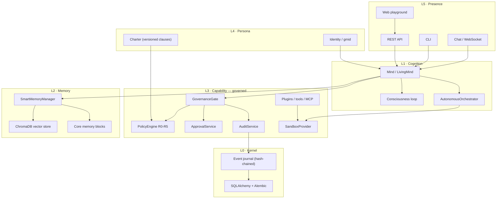
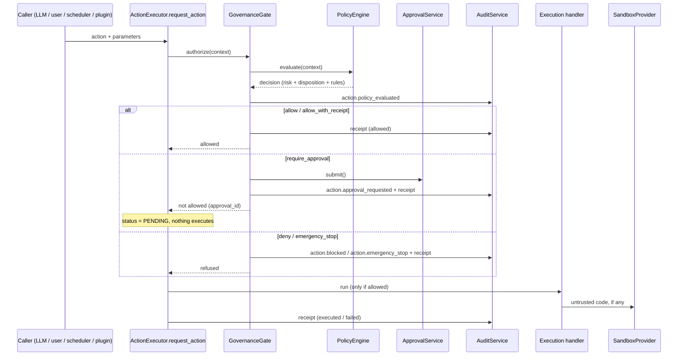

# Genesis Minds V3 — Developer Guide

> One document for anyone picking this repository up: what exists, what is
> claimed, what is not built yet, how to run it, and how to extend it.
>
> **The rule this document follows:** if a capability is not implemented, it says
> so. Nothing here describes behaviour that does not exist.

| | |
|---|---|
| **Branch** | `feature/v3-digital-beings-os` |
| **Baseline** | `main` @ `c730c6d` (v0.1.5-alpha, Jan 2025 framework) |
| **Last verified** | 2026-09-29 — full suite; the live sandbox/container checks below still date from 2026-09-28 |
| **Test suite** | **779 passed, 16 skipped, 9 failed, 1 error.** The 9 failures and the error are pre-existing and unchanged — each confirmed by re-running against a stashed pristine tree. See §10 |
| **Container** | Image builds; runs `Up (healthy)`; all 9 governance endpoints verified live in the final image |
| **Sandbox isolation** | Verified against a real container: 10/10 claims held, 11 escape tests in the suite |
| **Governance version** | policy `genesis-policy-2026.09.1`, charter `genesis-charter-2026.09.2` |

---

## 1. What this repository is

Genesis is a framework for running **persistent, autonomous AI agents** ("Minds")
that own a workspace, hold memory, act on a schedule, and — after this branch —
do so under a deterministic, auditable governance control plane.

Read it as two things stacked:

1. **A cognitive architecture** (inherited, largely unchanged): a cost-aware 24/7
   cognition loop, multi-type memory with decay and consolidation, goals, roles,
   relationships, plugins, environments, a market, and a code-generation agent.
2. **A runtime with a security and accountability spine** (this branch): every
   untrusted execution goes through a sandbox provider, and every consequential
   action passes a deterministic policy gate that produces an approval request or
   an immutable receipt.

The interesting engineering in this branch is almost entirely in (2). (1) is the
asset being protected.

---

## 2. Architecture

### 2.1 Layer model



**Solid in this branch:** L3 governance, L3 sandbox routing, L0 journal.
**Inherited, not yet restructured:** L1/L2 remain inside the `Mind` god-object
(`genesis/core/mind.py`, ~99 KB). Splitting it is Phase C and is *not* done.

### 2.2 The governed action path

This is the single most important flow to understand. It is what changed.



**Two properties worth stating explicitly because they are load-bearing:**

1. **The gate runs before the legacy autonomy ladder.** The old ladder denied
   confirmation-required actions outright, with the comment
   *"not implemented in auto mode"*. That meant a consequential action could
   never reach the approval queue that is supposed to authorize it. Ordering is
   now: gate → legacy ladder (confidence/proactive switch) → execute.
2. **The gate fails closed.** If policy evaluation or the gate itself throws, the
   action is *refused*, not permitted. A control plane that degrades to
   "allow everything" when it breaks is not a control plane.

### 2.3 Risk levels and dispositions

| Level | Meaning | Disposition |
|---|---|---|
| **R0** | Read-only public / owner-authorized data | `allow` |
| **R1** | Reversible, inside the Mind's own isolated workspace | `allow_with_receipt` |
| **R2** | Modifies a connected external workspace | `require_approval` (a tenant standing grant may auto-approve, capped at R2) |
| **R3** | External communication, deployment, purchase, privileged admin | `require_approval` — a tenant policy can never lower this |
| **R4** | Legal, medical, financial, employment, safety-critical, physical-world | `require_approval` **with a human approver** |
| **R5** | Prohibited / destructive / constitutionally disallowed | `deny` (or `emergency_stop` if catastrophic) |

Invariants enforced in code and covered by tests:

- An **undeclared capability floors at R3**. There is no permissive default.
- A capability whose *name* matches a dangerous pattern (`harm`, `bypass`,
  `exfiltrat`, …) is R5 even if nobody declared it. Physical names (`robot`,
  `actuator`, `gripper`, …) are at least R4.
- A **model advisory signal can raise the required control, never lower it.**
- Tenant policy may widen autonomy only up to R2, and only when scoped to named
  capabilities or categories. A blanket grant is ignored.
- The engine is **pure**: same context ⇒ same decision, verified by test.

### 2.4 The emergency stop

`EmergencyStopService` is a state machine, not a flag:

- Engaging halts everything above R0. Read-only observation stays available so a
  human can inspect the Mind.
- Attempting an R5 *catastrophic* capability **latches** the stop automatically.
- A Mind cannot release its own stop; a human must.
- State is journaled, so `rehydrate(mind_id)` rebuilds it from the event log
  after a restart.

### 2.5 The approval state machine

```
PROPOSED → POLICY_EVALUATED → WAITING_FOR_APPROVAL
                                 ├─ APPROVED  → EXECUTING → COMPLETED
                                 │                        ├─ FAILED
                                 │                        └─ ROLLED_BACK
                                 ├─ REJECTED
                                 ├─ EXPIRED
                                 └─ CANCELLED
```

Illegal transitions raise `ApprovalTransitionError`. Every accepted transition is
journaled with its actor and note.

**Grant binding** — the security core:

| Rule | Enforcement |
|---|---|
| Bound to exact **material** parameters | `parameters_hash` over the params minus non-material narration keys (`reasoning`, `note`, `correlation_id`, …). Whitespace and key order are normalised. |
| Bound to one **mind**, one **capability**, one **scope** | Checked at redemption. |
| Bound to an **expiry** | Default grant TTL 15 minutes, default request TTL 24 hours. |
| **Single-use** | `consumed_at` is set on redemption; a replay fails closed. |
| **Revocable** until executed | After execution the escape hatch is rollback, not revocation. |
| Human-required actions | `ApprovalService.approve` refuses an actor of type `mind` when `requires_human` is set. |

The approval card shown to a human is **generated from facts** (capability name,
risk level, material parameters), never from model prose. A persuasive model
cannot write its own approval rationale.

### 2.6 The event journal and receipts

- **Append-only**, hash-chained *per (tenant, mind) stream*. Each event carries
  `sequence`, `prev_hash`, `payload_hash`, and `integrity_hash`. Sequence and
  `prev_hash` are assigned **inside the store**, atomically with the insert, so
  two concurrent writers cannot fork the chain.
- **Redacted by construction.** Redaction happens in `AuditService.record`, so a
  caller cannot persist a secret by passing one in. Sensitive mapping keys are
  replaced wholesale (including `credentials`, which redacts its whole subtree).
  Inline credential shapes (`Bearer …`, `sk-…`, `AIza…`, PEM blocks, SSN/card
  shapes) are stripped from free text.
- **Bounded.** Payloads are shrunk deterministically to fit the byte cap.
- **Receipts exist for every attempt**, including blocked and failed ones — the
  blocked ones are the highest-interest records for a security review.
- `verify_journal` re-walks the chain and reports the first broken link.

`AuditService` is usable without an observability stack. Tracing is for
operations; the journal is for accountability. The system must work with
tracing disabled.

---

## 3. Status: what is real

Legend: **✅ implemented and tested** · **⚠️ partial, honestly reported** ·
**🚧 designed, not built**

### 3.1 Governance control plane — ✅ complete

| Component | Path | Tests |
|---|---|---|
| Policy engine (R0–R5, five dispositions) | `genesis/governance/policy.py` | `tests/governance/test_policy.py` |
| Capability registry + inference | `genesis/governance/risk.py` | same |
| Versioned charter rules (13 clauses) | `genesis/governance/constitution_rules.py` | `tests/governance/test_constitution_bridge.py` |
| Approval state machine + grants | `genesis/governance/approval.py` | `tests/governance/test_approval.py` |
| Event journal + receipts | `genesis/governance/audit.py`, `models.py`, `receipts.py` | `tests/governance/test_audit.py` |
| Redaction | `genesis/governance/redact.py` | `tests/governance/test_audit.py` |
| Orchestration facade | `genesis/governance/guard.py` | `tests/governance/test_gate.py` |
| Persistence (memory + SQLAlchemy) | `genesis/governance/store.py` | `tests/governance/test_audit.py` |
| Emergency stop | `genesis/governance/estop.py` | `tests/governance/test_gate.py` |
| Executor integration | `genesis/core/action_executor.py` | `tests/governance/test_action_executor_governance.py` |
| REST API (12 endpoints) | `genesis/api/governance_routes.py` | `tests/governance/test_governance_api.py` |
| Migration-chain guards | `alembic/versions/` | `tests/test_migrations.py` |
| Durable store (the one production uses) | `genesis/governance/store.py` | `tests/governance/test_sql_store.py` |

**587 tests across governance, security and migrations** (305 governance + 251 security + 31
migration guards). The suite covers the R0–R5 matrix, undeclared-capability flooring,
advisory-can't-lower, budget refusal, lifecycle halting, tenant blocks and the R2 cap, scope
escalation, emergency-stop latching *and* rehydration from the journal, grant
parameter-mutation/replay/cross-mind/expiry, journal tamper detection and splicing, redaction of
secret-shaped keys and inline credentials, the full approval-to-redemption lifecycle, end-to-end
executor flow including "the handler must not run before approval", correlation scoping and
`explain_chain`, the domain journal's two guarantees (no content, never breaks the caller), and the
commitment state machine including refused illegal transitions and third-party fail-closed defaults.

Two bug classes were found only by going beyond the unit suite, and both now have guards:

* **The migration chain could not be applied to a fresh database** (three revisions created the
  same index twice). Found by running `alembic upgrade head` against a scratch database, not by
  the tests. Guarded by `tests/test_migrations.py`.
* **Every multi-row read on the durable store raised `DetachedInstanceError`**, because rows were
  converted to dataclasses after the session had closed. Invisible while a table is empty, so it
  surfaced as `GET /journal/verify` returning 200 and then 500 once its own event was written.
  Found by running the built container and calling the endpoints. Guarded by
  `tests/governance/test_sql_store.py`, which exercises the real SQLAlchemy store — the in-memory
  store used by every other test cannot reproduce it.
* **A Mind's creator could not open the Mind they had just created.** `Mind.birth` defaults
  `creator` to the literal string `"anonymous"` and the create route never passed anything else, so
  that default was written to `MindRecord.creator` — the column the access check reads. The result
  was `403 Access denied to this Mind` on your own Mind, with nothing in the response explaining
  why. Found by creating a Mind through the running app and then opening it. Guarded by
  `tests/test_mind_ownership.py`, including that the repair path cannot be used to take over a Mind
  that already has an owner.

Note what these three have in common: two are *defaults* that were never overwritten, and one is a
resource released before it was read. None of them is a logic error a test of the logic would catch.
They were all found by exercising the deployed path and looking at what came back.

### 3.2 Security containment — ✅ Phase B functionally closed

| Item | State |
|---|---|
| SEC-01 unauthenticated WebSocket + identity spoofing | ✅ fixed, verified live |
| SEC-02/SEC-14 path traversal, arbitrary file read/write, unbounded upload | ✅ fixed, 9/9 live checks |
| SEC-04 runtime `pip install` from model output | ✅ removed (both providers refuse before starting) |
| SEC-06 unenforced `ALLOWED_IMPORTS` claim | ✅ claim deleted, not faked |
| SEC-05 environment inheritance | ✅ **closed** — the sandbox scrubs its env, and MCP servers now get a base allowlist with secrets refused even when explicitly requested |
| Sandbox provider + all 3 execution paths | ✅ `genesis/sandbox/`, AST guard test |
| Filesystem / PID / network isolation | ✅ **closed** — `ContainerSandboxProvider` provides read-only rootfs with one writable mount, cgroup-scoped PID and memory limits, `--network none`, `--cap-drop ALL`, no-new-privileges, and an optional gVisor/Kata kernel boundary. Verified against a real container: 10/10 isolation claims held, 11 escape tests in the suite. |
| Egress blocking | ✅ **closed and verified** — isolation is *probed*, not inferred: `verified` requires the host to have egress **and** the namespace to block it. Every execution records `network_isolated` so the receipt states the fact. |
| API-tier process spawning (B11) | ✅ **closed** — lifecycle delegates to `GENESIS_SUPERVISOR`; the default refuses with the operator command rather than forking. `routes.py` is AST-guarded against spawning or signalling anything. |
| Placeholder signing key (B12) | ✅ **closed** — the app refuses to boot with it outside test/dev, and an unset `GENESIS_ENV` counts as production |
| `LocalSandboxProvider` honesty | ✅ still reports `is_security_boundary: false`; `factory` refuses to fall back to it when `container` is requested |

**Phase B is closed.** The only remaining item is `mypy` cleanliness, which is linting, not a security boundary.

### 3.3 Developer experience

| Item | State |
|---|---|
| Test suite runs without paid API keys | ✅ |
| 779 passing tests, 16 skipped | ✅ |
| `genesis/channels/` — the digital-presence substrate | ✅ **built** — protocol, registry, enforced disclosure, contactability floors, approval-integrity digest, `ChannelGateway`. 27 substrate tests + 52 provider/gateway tests + 34 contact-store tests. Provider setup: `CHANNEL_PROVIDERS.md` |
| Container sandbox escape tests | ✅ 11 tests, skipped when no runtime/image is present rather than silently passing |
| Alembic migration for governance tables | ✅ `008_governance_plane`, verified upgrade → downgrade → upgrade → `downgrade base` → upgrade |
| Migration chain usable from a fresh database | ✅ **fixed** — three earlier revisions created the same index twice (`index=True` *and* an explicit `create_index`), so `alembic upgrade head` aborted partway and every later revision, including the governance one, was unreachable on a new install. Guarded by `tests/test_migrations.py`. |
| SQL store covered by tests | ✅ **fixed** — every multi-row read raised `DetachedInstanceError` (rows converted after the session closed). Invisible while a table is empty, so it surfaced as `GET /journal/verify` returning 200 then 500. Guarded by `tests/governance/test_sql_store.py`. |
| CI (lint ratchet, tests, migration up/down) | ✅ **built** — `.github/workflows/ci.yml`, three jobs. Verified locally before committing |
| `mypy genesis` clean | 🚧 not built (A4) |
| Deterministic per-test isolation of ChromaDB / `~/.genesis` | ✅ **fixed** (A2) — the vector store takes an explicit mode; the suite runs `GENESIS_VECTOR_STORE_MODE=ephemeral` and an autouse fixture fails the session if it is not. This removed two of the "pre-existing failures" from the failure column: they were the shared ChromaDB, not the code. |

---

## 4. Status: what is *not* real

Be careful with these — several are asserted in public material and are not true.

| Claim / feature | Reality |
|---|---|
| "Consciousness" | Not claimed by the code. The mechanism is a periodic cognition loop with awareness levels and budget caps. |
| "Violations cannot be bypassed via prompt injection" | Was false (a substring scan). The *action* boundary is now enforced deterministically; prompt screening is labelled advisory. Note that injection through *content* was a real gap until recently — see the markdown renderer row below. |
| Model output is safe to render | It was not. `MarkdownRenderer` passed message bodies to `dangerouslySetInnerHTML` without escaping, so a reply containing `` executed in the reader's browser, and `[x](javascript:…)` produced a working link. Escaping now happens before formatting, and link schemes are allowlisted. |
| `require_approval_for_external_actions` | Was a lie (the approval path did not exist). It now works — but note the setting itself is still not read by the policy engine; risk classification is the control. |
| Filesystem-isolated sandbox | **Depends on the provider.** `container` is a real boundary (verified against a real runtime: 10/10 isolation claims held, 11 escape tests). `local` is a resource limiter and says so about itself. Never assume — read `capabilities()` |
| Network isolation | Verified, not assumed: `verified` requires the host to have egress **and** the namespace to block it. If the probe cannot prove both, the sandbox reports `verified: false` with the reason and the receipt records the fact |
| Memory as a temporal knowledge graph / bi-temporal store | Not implemented. ChromaDB + a relevance multiplier; cannot express "true from March, superseded in July". ADR-0003/0004 describe the target. |
| Portable signed identity (DID / verifiable credentials) | Not implemented. `gmid` is a local identifier. |
| A Mind can email and call | **Adapters exist, none has been called.** `HostingerMailChannel`, `RinggVoiceChannel`, `EmailChannel` and `TelegramChannel` implement the protocol and pass tests against a fake transport, but no real message has been sent and no real call placed — neither account exists yet. Hostinger's send path is documented; its read paths are inferred. Run `adapter.verify()` before the first real use |
| A Mind can receive inbound mail | **Not wired to the daemon.** `ChannelGateway.handle()`/`drain()` implement and test the loop, but nothing schedules it, and there is no webhook ingestion. Inbound is nothing more than a returned object today |
| Voice transcription | Not implemented. Ringg's assistant speaks; the transcript arrives later by webhook or from call history, and neither is ingested. `RinggVoiceChannel.capabilities().can_receive` is `False` |
| Contact persistence | Not implemented. The only `ContactResolver` is `InMemoryContacts`, which returns every unknown sender as reply-only with no `consent_source`. A Mind does not yet remember who it has spoken to |
| Durable outbound rate limits | Not implemented. `InMemoryOutboundLedger.durable` is `False`, so the weekly cap and minimum gap are a per-process floor that a restart clears. `InMemoryOutboundLedger` reports this itself rather than claiming otherwise |
| Hosted MCP servers | **Unreachable.** `MCPClient.connect()` implements only `STDIO` and logs "HTTP/WS transport not yet implemented" for the two other transports it declares. `MCPServerConfig.command` is required, which no remote server has. HTTP/SSE transport is a prerequisite, not a config change |
| Realtime voice (`GEMINI_LIVE_MODEL`) | Not implemented. The setting is read and reported, but there is no Live API client — bidirectional audio is a feature, not a configuration. The implemented speech paths are single-shot: `genesis/senses/speech_input.py` and `speech_output.py`. |
| Durable multi-process kernel, checkpoints, resume | Not implemented. |
| Embodiment | Not implemented. `actuate_robot` exists only as a **governance** entry at R4. |
| Evals harness, OpenTelemetry tracing | Not implemented (B17, B18). |
| Prompt screening precision | The keyword scan still produces false positives (it flags "kill a process"). It no longer blocks the turn — it logs and continues — which is the correct fix per ADR-0006, but the keyword lists themselves are unreviewed. |

---

## 5. Running it

### 5.1 Single container (recommended for a VPS)

```bash
cp .env.example .env
# REQUIRED: compose fails fast without these two
python -c "import secrets; print(secrets.token_hex(32))"      # -> API_SECRET_KEY
python -c "import secrets; print(secrets.token_urlsafe(24))"   # -> GENESIS_ADMIN_PASSWORD
# and at least one model provider key, e.g. OPENROUTER_API_KEY
docker compose up -d --build
```

Then open `http://<host>:8080`. nginx is the front door; the API, the built
playground, and static assets are served behind it. Supported on a small VPS
(~1 vCPU / 1 GB) for a handful of Minds.

**Verified in the built image**, not just locally: container `Up (healthy)`; built-in JWT login via
`POST /api/v1/auth/token`; `GET /auth/me`; and all nine governance endpoints returning 200,
including `GET /journal/verify` called twice in a row. Two more facts were checked in that same
image: requesting `GENESIS_SANDBOX_PROVIDER=container` where no runtime exists **refuses** rather
than falling back to `local`, and `LocalSandboxProvider.capabilities()` still reports its four
isolation claims as `false` with the reason, even from inside a container. Note that Firebase is
genuinely optional: `GET /api/v1/auth/firebase/status` reports it disabled on a default install,
and the web workspace offers a username/password sign-in that talks to the API directly. Until
recently it did not, so a Firebase-less install could not be signed into at all.

Full details, including the volume layout and TLS: `docs/v3/DEPLOYMENT_SINGLE_CONTAINER.md`.

### 5.2 Local development

```bash
python -m venv .venv && . .venv/Scripts/activate     # Windows
pip install -e ".[dev]"

# Governance must not run on the non-durable store outside test/dev — it refuses to.
export GENESIS_ENV=development                       # PowerShell: $env:GENESIS_ENV="development"
export GENESIS_GOVERNANCE_STORE=memory

pytest tests/governance -q

# `server.py` exposes a FACTORY, not a module-level `app`, so --factory is required.
uvicorn genesis.api.server:create_app --factory --reload
```

In development the API seeds `admin` / `genesis-admin-2026` for convenience. That
password is in this repository, so a process running in development mode must not
be reachable from a network — which is also the reason it is not seeded anywhere
else. To use a real one locally, set `GENESIS_ADMIN_PASSWORD` and it takes
precedence.

Migrations:

```bash
alembic upgrade head      # applies 008_governance_plane
alembic downgrade -1      # drops the four governance tables
```

### 5.3 Environment variables that matter

| Variable | Default | Notes |
|---|---|---|
| `GENESIS_ENV` | unset | Treats as `production` when unset. `test`/`development` required for the non-durable governance store and the fake sandbox |
| `GENESIS_GOVERNANCE_STORE` | `sql` | `memory` is refused outside test/dev, because a non-durable journal breaks the accountability guarantee |
| `GENESIS_SANDBOX_PROVIDER` | `local` | `fake` is refused outside test/dev. `container` fails closed if its runtime is unusable — it never falls back to `local` |
| `GENESIS_SANDBOX_RUNTIME` | daemon default | `runsc` (gVisor) or `kata-runtime` for a kernel boundary. Asking for one that is absent refuses rather than using `runc` |
| `GENESIS_SANDBOX_REQUIRE_ISOLATION_RUNTIME` | off | Refuse to run at all unless gVisor/Kata is present |
| `GENESIS_SANDBOX_IMAGE` | `genesis-sandbox:latest` | Pre-baked; nothing is ever installed at runtime |
| `GENESIS_SANDBOX_EGRESS_PROXY` | unset | Required when a policy enables network access, because plain Docker networking cannot restrict destinations |
| `GENESIS_SUPERVISOR` | `none` | `systemd` delegates Mind daemon lifecycle. `none` returns 501 with the operator command rather than forking from the API |
| `API_SECRET_KEY` / `SECRET_KEY` | placeholder | The app **refuses to boot** with the placeholder outside test/dev |
| `GENESIS_ADMIN_PASSWORD` | unset | Bootstraps the first admin account. **Required by `docker-compose.yml`.** Minimum 12 characters; a shorter value is refused and no account is created. There is no default — the published development password is seeded only in test/development. See §4 |
| `GENESIS_ADMIN_EMAIL` | `admin@genesis.local` | Address recorded for the bootstrap admin on first start |
| `OPENAI_ENDPOINT` | unset | Base URL for any OpenAI-compatible service. Unset means api.openai.com. A key from a gateway or router cannot work without this |
| `OPENAI_MODEL` | unset | Model name for that endpoint. Passed through unchanged — only the endpoint knows its own namespace |
| `GEMINI_IMAGE_MODEL` | unset | Image generation. With `GEMINI_API_KEY` set, replaces the free Pollinations fallback for avatars and contextual images |
| `GEMINI_LIVE_MODEL` | unset | **Recorded but not wired.** Realtime voice has no client in this codebase; setting it changes no behaviour. `GET /system/providers` reports `implemented: false` for it |
| `DATA_DIR`, `MINDS_DIR`, `LOGS_DIR` | `~/.genesis/*` | Independent settings — do not assume they follow `GENESIS_HOME` |
| `GENESIS_VECTOR_STORE_MODE` | from settings (`persistent`) | `ephemeral` keeps ChromaDB in memory. Read from the environment, not from `Settings`, because `Settings` has no `env_prefix` — a field named `vector_store_mode` would look for `VECTOR_STORE_MODE`. The test suite requires `ephemeral` |
| `MIND_ADMINISTRATOR_NAME` | `"the system operator"` | Named in every disclosure signature. A Mind whose messages are signed by nobody in particular has not disclosed anything |
| `MIND_HOSTINGER_MAIL_API_TOKEN` + `MIND_HOSTINGER_MAILBOX_ID` + `MIND_HOSTINGER_MAIL_ADDRESS` | unset | The Mind's email via the Hostinger Mail API. **Both token and mailbox id are required** — email is not registered with only one, because half a credential fails on first use. Token comes from hPanel → Agentic Mail → API access and is shown once. See `CHANNEL_PROVIDERS.md` |
| `MIND_HOSTINGER_MAIL_BASE_URL` / `_API_VERSION` | `https://api.mail.hostinger.com` / `v1` | Overridable. Hostinger's *hosting* API is a different service at a different URL with different tokens and cannot send mail |
| `MIND_EMAIL_*` | unset | Fallback IMAP/SMTP mailbox, used only when no Hostinger Mail token is set. For Gmail use an App Password |
| `MIND_TELEGRAM_BOT_TOKEN` | unset | Bot identity from @BotFather. The easiest real channel: no business verification, and a bot cannot message a user who has not started the chat |
| `MIND_RINGG_API_KEY`, `MIND_RINGG_AGENT_ID`, `MIND_RINGG_FROM_NUMBER_ID` | unset | Voice via Ringg AI. Ringg's assistant speaks from a prompt in *its* dashboard; the Mind decides who and what context |
| `MIND_RINGG_DISCLOSURE_CONFIRMED` | `false` | **An assertion, not a check.** The channel does not register while this is false. No Ringg API returns the assistant's prompt text, so we cannot verify it discloses; the operator has to say so, and that statement is recorded. See §9 of `DIGITAL_PRESENCE.md` |
| `MIND_RINGG_CALL_WINDOW` | `09:00-18:00` | Sets **our** quiet-hours floor to match the window configured in Ringg, which enforces its own. If ours is wider the Mind believes a call is allowed and the provider refuses it as an unexplained delivery error instead of a policy refusal. Unparseable keeps the default and warns |

> **Naming:** these are `MIND_*`-prefixed because `Settings` has **no `env_prefix`** — a
> field name *is* the environment variable name. An unprefixed `email_password` would
> collide with a host variable of the same name.

---

## 6. Extending it

### 6.1 Adding a capability

Capabilities declare their own risk. If you register an action with
`ActionExecutor.register_action`, a profile is derived automatically from its
category, permission level, and legacy risk score. Derive conservatively:

```python
from genesis.core.action_executor import ActionDefinition, ActionCategory
from genesis.core.autonomy import PermissionLevel

executor.register_action(ActionDefinition(
    name="publish_report",
    category=ActionCategory.COMMUNICATION,      # -> external, not reversible
    description="Publish a report to the shared drive",
    parameters={"path": {"type": "string", "description": "Target", "required": True}},
    permission_level=PermissionLevel.REQUIRES_CONFIRMATION,   # -> R3
    risk_level=0.5,
    execution_handler=publish_report,
))
```

To declare richer facts (data sensitivity, required scopes, physical impact),
register an explicit profile — the reviewed declaration wins over the derived one:

```python
from genesis.governance import CapabilityProfile, RiskLevel, register_capability

register_capability(CapabilityProfile(
    name="publish_report",
    risk=RiskLevel.R3,
    category="COMMUNICATION",
    external=True,
    reversible=False,
    data_sensitivity="confidential",
    required_scopes=("files.publish",),
))
```

A capability you forget to declare is **gated at R3**, not permitted. That is
deliberate friction.

### 6.2 Adding a policy rule

Add a clause to `genesis/governance/constitution_rules.py` with a stable
`clause_id`, then reference it from `PolicyEngine._evaluate` by appending it to
`matched_rules`. Two tests will hold you to it:

- `test_every_constitutional_violation_maps_to_a_clause` — fails if a
  `ConstitutionalViolation` has no enforcing clause.
- `test_prohibited_capabilities_point_at_prohibit_clauses` — fails if a
  capability maps to a clause that is not marked `PROHIBIT`.

Rules are code and must be reviewed and versioned like code. Bump
`CHARTER_VERSION` (and `POLICY_VERSION` if the engine changes) when you do.

### 6.3 Emitting a governed event

```python
from genesis.governance import get_audit_service

audit = get_audit_service()
audit.record(
    "skill.learned",                 # event families are plain strings, not an enum,
                                     # so new types are additive
    mind_id=gmid,
    actor_type="mind",
    actor_id=gmid,
    correlation_id=correlation_id,
    payload={"skill": name, "proficiency": 0.4},   # redacted on write
)
```

`EventType` holds the event names the current code emits; a reader tolerates an
unknown value, so adding a family is a one-line change. Never write a secret into
a payload expecting it to be dropped — it *will* be dropped, but pass it through
`redact_payload` yourself if you need the redacted form elsewhere.

### 6.4 Adding a governance endpoint

Follow `genesis/api/governance_routes.py`: call `assert_mind_read_access` for
reads and `assert_mind_owner` for writes. Do not invent a third check — the
existing pair is what the tests exercise, including failing closed when the
database is unreachable.

---

## 7. Plan

Ordering is by what unblocks what. Phase B is a gate that is now closed on
security; the remaining items are engineering hygiene.

### Phase B — status

| ID | Item | State |
|---|---|---|
| **B2b** | `ContainerSandboxProvider` — filesystem, PID, cgroup and network isolation, with an optional gVisor/Kata kernel boundary | ✅ **Done** — verified against Docker with 10/10 isolation claims held, and 11 escape tests in the suite |
| **B5** | Egress | ✅ **Done** — isolation is now *verified* rather than inferred; each execution records whether egress was actually blocked |
| **B9** | MCP servers no longer inherit the host environment | ✅ **Done** — base allowlist, secrets refused even when explicitly requested |
| **B11** | API-tier process spawning removed; lifecycle delegated to a supervisor | ✅ **Done** — default refuses with the operator command rather than silently forking |
| B12 | Refuse to boot on a placeholder signing key | ✅ **Done** |
| A2 | Test isolation | ✅ **Done** — `GENESIS_VECTOR_STORE_MODE=ephemeral`, enforced by an autouse fixture. This removed two of the "pre-existing" failures: they were the shared ChromaDB, not the code |
| A6 | CI | ✅ **Done** — tests on 3.11 and 3.12, migration up/down from an empty database, sandbox policy guards |
| A4 | `mypy` clean | 🚧 open |

**Phase B is closed.** The remaining item is linting, not a security boundary.

### Phase C — kernel extraction (behaviour-preserving)

Split `Mind` (`genesis/core/mind.py`, ~99 KB) into kernel / persona / capability /
memory / cognition. This is what unlocks snapshotting, forking, multi-process
daemons and embodiment.

**Includes the `Body` protocol** (`perceive` non-blocking, `act` refusable,
`observe` side-effect-free) plus `NullBody` and `WebBody`. Doing this here rather
than in Phase L is deliberate: the shape of the actuation seam is what constrains
the kernel split, and defining it later means reconciling four separate paths
(chat, voice, workspace, robot). See `EMBODIMENT_ABSTRACTION.md`.

### Phase N — Digital Life State *(promoted above memory V3)* — ✅ commitments done

Commitments are implemented: `genesis/core/life/commitments.py`, with beneficiary,
deadline, provenance, a refused-illegal-transitions state machine, overdue tracked
separately from MISSED, third-party creation gated at R3 with a fail-closed
default, and journalling that deliberately *includes* the obligation text because
an obligation nobody can read is not an obligation.

Still to do in this phase: responsibilities as first-class records, projects,
habits, assets, calendar, and the workspace surface (N5–N10).

See `DIGITAL_LIFE_STATE.md` for the full design and the ordering rationale.

### Phase O — Relationship intelligence

Trust scoped per domain, relational memory, shared history, and **boundaries**
(what not to mention or share). See `RELATIONSHIP_INTELLIGENCE.md`.

Boundaries are the one piece worth pulling forward into Phase N: they are cheap,
they only ever *restrict* a being, and they give a user immediate control over
something already acting on their behalf.

### Phases D–M

- **D** Journal as the timeline of record: wire the remaining write paths, add
  checkpoints/resume.
- **E** Memory V3: bi-temporal (ADR-0004), pgvector (ADR-0003), hybrid retrieval.
- **F** Portable identity. The artifact is specified in
  `PORTABLE_BEING_FORMAT.md`. The hard half is not the file format — it is signing,
  which does not exist at all today (`gmid` is a local string).
- **G** Durable governed autonomy: suspend/resume on approval without spinning.
- **H** Workspace — also the surface where commitments become visible to a human.
- **I** MCP + skills marketplace with risk declared per skill.
- **J** Realtime voice presence (barge-in, transcript-as-memory).
- **K** Enterprise controls: tenancy, per-tenant policy, audit export, SSO.
- **L** Embodiment hardware. **`ROSBody` must refuse rather than actuate** until a
  physically independent emergency stop exists that fails *safe*.
- **M** Genesis World.

### Recommended next three, in order

1. **P2 — contact identity, and a registry on `Mind`.** This is the blocker for
   everything in `DIGITAL_PRESENCE.md`. The gateway is written and tested, but the
   only `ContactResolver` is `InMemoryContacts`, so a Mind cannot remember who it
   has spoken to and every stranger is reply-only forever; and `Mind` has no
   `channels` attribute, so `action_executor._execute_send_email` — which already
   reads `getattr(self.mind, "channels", None)` — finds `None` and refuses
   honestly. Two pieces of scaffolding, and the adapters become reachable.
2. **Drive the gateway from the daemon** — an inbound poll on the existing
   scheduler, with a stated approval policy for replies. Without this, a Mind can
   address someone but can never answer, which is the half of the feature the user
   actually asked for. Decide the policy first: auto-approve replies to known
   contacts inside a thread is the defensible default, and everything else keeps
   its R2/R3 decision.
3. **Phase C kernel extraction** — split the ~99 KB `Mind`, and define the `Body`
   protocol while doing it. This is the gate for forking, multi-process daemons
   and embodiment.

**Deliberately not on this list: more providers.** Twilio, WhatsApp and social
publishing each need an external human to say yes first, and both of the two
adapters that exist have never been called. Adding a third unexercised adapter
would add surface without adding anything a user can do. Run `verify()` against
one real account — Hostinger is the cheapest of the two to stand up — and close
the gaps that finds before widening.

---

## 7b. How to read an assessment of this project

This document has been reviewed externally, and the reviews are useful for
prioritisation. They are not useful as a scorecard, and it is worth saying why.

**They are grading the documentation, not the code.** The review that produced
scores of "Implementation 7.5/10, Architecture maturity 8/10, Memory 7/10" was
assessing a document whose own §4 lists: no bi-temporal memory, no filesystem
isolation (until the same day), MCP leaking the host environment, no portable
identity, no embodiment, and a `Mind` god-object blocking all of it. Those are not
7/10 facts. A document that is honest about its gaps will be *scored against its
own candour* unless the reviewer checks the repository — so a well-written status
doc reads as a better system than it is.

Concrete corrections, from the code:

| Assessed | Actual |
|---|---|
| Robot readiness 5/10 | **No hardware layer exists.** `actuate_robot` is a risk classification with nothing behind it. 1/10. |
| Governance 9/10 | The plane is ~a day old and has never run under real load. The gate was still open this morning. Promising, unproven. |
| Memory 7/10 | Decay cannot express supersession ("true until July"). Bi-temporal is Phase E. 5/10. |
| Research novelty 9/10 | The components are known patterns (policy-as-code, hash-chained audit, HITL approval). The *combination* applied to persistent beings is less common — call it 6/10 novelty, 8/10 usefulness. |
| "Implementation 7.5/10" | The two bugs found by running the code today were a migration chain that could not execute and every multi-row read raising `DetachedInstanceError`. Neither was found by review. |

**What the reviews got right, and led to plan changes:**

- *Life state is the missing piece.* Correct, and now Phase N — promoted above
  memory V3.
- *Embodiment should be an interface before it is hardware.* Correct, and the
  `Body` protocol moved into Phase C.
- *Relationships are richer than a typed edge.* Correct, and now Phase O.
- *Don't build a thousand agents or a marketplace yet.* Agreed; both were already
  sequenced late and remain so.
- *Positioning as an operating system rather than a framework.* Already the V3
  framing.

The useful part of an external review is the **prioritisation**, not the score.
A score from someone who has not run the code is a sentiment signal; the
repository, the tests, and the container are the evidence.


## 8. Ground rules for work on this branch

These are not style preferences; each one exists because breaking it caused a real
problem in this repository.

1. **Never fabricate completion.** If something is partial, say "partial" and say
   what is missing. Several documents in this repo failed that test and had to be
   rewritten.
2. **The governance gate fails closed.** Any new code path that could bypass it
   must refuse rather than permit when it cannot decide. There is a test for the
   gate's own failure mode; keep it passing.
3. **The LLM is never the authority.** Output of a model — including a risk
   classifier — may *raise* the required control, never lower it.
4. **Redaction happens in the writer.** Never rely on callers to clean payloads.
5. **Sequence and `prev_hash` are assigned by the store**, atomically with the
   insert. Do not compute them in a service.
6. **`str.startswith()` is never a containment check.** Use `genesis/core/paths.py`.
7. **An optional feature must not take the process down.** A missing vision
   dependency previously crashed API startup; that guard is now broad, and new
   optional imports should be too.
8. **Test the property, not the implementation.** `test_every_constitutional_violation_maps_to_a_clause`
   exists to fail when someone adds a violation without a rule. Write more like it.

---

## 9. Where things live

```
genesis/
  governance/          # the control plane
    policy.py          #   PolicyEngine, decisions, PolicyContext
    risk.py            #   R0-R5, capability registry, conservative inference
    constitution_rules.py  # 13 versioned clauses mapped to the charter
    approval.py        #   state machine, parameter-bound single-use grants
    audit.py           #   event journal + receipts, redaction in the writer
    redact.py          #   redaction primitives (pure)
    receipts.py        #   receipt construction + error taxonomy
    estop.py           #   emergency stop with journal rehydration
    guard.py           #   GovernanceGate: the single entry point
    context.py         #   correlation scope: causal chains across a turn
    domain_events.py   #   the journalisation helper for domain code
    store.py           #   memory + SQLAlchemy persistence, hash chaining
  sandbox/             # untrusted execution boundary
    base.py            #   SandboxProvider protocol, policy, result types
    local.py           #   hardened subprocess + verified network probe
    container.py       #   filesystem/PID/cgroup/network isolation, gVisor|Kata
    factory.py         #   provider selection; refuses security downgrades
    tool_runner.py     #   tool execution; carries isolation facts to receipts
  core/
    action_executor.py # gate -> legacy ladder -> execute -> receipt
    constitution.py    # charter + adapter (no longer the mechanism)
    supervisor.py      # daemon lifecycle via systemd; no forking from the API
    paths.py           # path containment primitives
    code_executor.py   # routes through SandboxProvider
    life/
      commitments.py   # what a Mind owes, to whom, by when (Phase N)
  integrations/
    mcp_integration.py # MCP with a scrubbed environment (SEC-05)
  channels/            # the digital-presence substrate
    base.py            #   protocol + types: identity, capabilities, intents,
                       #   approvals (with a body digest), receipts, contacts
    disclosure.py      #   the AI marker: composed in the writer, idempotent
    limits.py          #   quiet hours, weekly cap, minimum gap, opt-out, ledger
    adapter.py         #   BaseChannel: prepare (pure) / send (gated)
    registry.py        #   per-channel enable/disable WITH a reason; credentials
    email.py           #   stdlib IMAP/SMTP fallback
    telegram.py        #   Bot API
    hostinger_mail.py  #   Hostinger Mail API: scoped token, threads, allow list
    ringg_voice.py     #   Ringg AI: the Mind picks context, Ringg speaks
    gateway.py         #   inbound -> responder -> floors -> gate -> send
    contacts.py        #   the durable contact store: who a Mind knows, consent per channel
    fake.py            #   FakeChannel: the test double the suite runs on
  api/
    governance_routes.py   # 12 endpoints: approvals, receipts, timeline, e-stop
  database/
    governance_models.py   # 4 tables
alembic/versions/20260928_0800_add_governance_plane.py
  security/test_contact_store.py   # 34 tests: consent per channel, per Mind; the stranger default
tests/
  governance/        # 305 tests: policy, approvals, audit, SQL store, gate, API,
                     #   correlation, domain events, commitments
  security/          # 397 tests: sandbox, container escapes, network probe, MCP env,
                     #   secrets, the bootstrap admin boundary, and the channels
                     #   substrate itself (test_channels.py 27, test_channel_providers.py 52,
                     #   test_contact_store.py 34)
  test_migrations.py # 31 tests: migration-chain guards
  test_mind_ownership.py # 8 tests: who may access a Mind, and placeholder repair
  security/test_default_admin.py   # 10 tests: the bootstrap-admin boundary
  security/test_persistent_users.py # 13 tests: accounts survive a restart
docs/
  architecture/adr/  # ADR-0001 .. ADR-0008
  v3/
    DEVELOPER_GUIDE.md            # this document
    CHANNEL_PROVIDERS.md          # how to configure email/voice, and what is unverified
    DIGITAL_PRESENCE.md           # the design: the Mind's body in the digital world
    DIGITAL_LIFE_STATE.md         # Phase N design: commitments, projects, habits
    RELATIONSHIP_INTELLIGENCE.md  # Phase O design: trust scopes, boundaries
    EMBODIMENT_ABSTRACTION.md     # Body protocol + ROSBody safety preconditions
    PORTABLE_BEING_FORMAT.md      # the .genesis export format (Phase F)
    THREAT_MODEL.md, IMPLEMENTATION_BACKLOG.md, TARGET_ARCHITECTURE.md, ...
  GENESIS_CONSTITUTION.md   # the human-readable charter
```

---

## 10. Known issues

| Issue | Impact | Notes |
|---|---|---|
| 9 test failures + 1 collection error | Pre-existing | Reproduce on the pristine tree (`git stash` is how they were classified). Environment/interpreter-specific (`test_emotional_intelligence` ×2, `test_admin`, `test_conversation_api`), the shared ChromaDB store (`test_memory`), and three that look like genuine product defects (`test_environment_access_controls`, `test_mind_gens_coercion`, `test_create_mind_with_auth`) |
| No channel adapter has been run against a real provider | **Medium** | Written from documentation. Hostinger's send path is quoted verbatim in their SDK docs; its read paths are inferred from a documented convention, and a message's field names are not documented at all. Run `verify()` before the first real send or call, and prefer acting on its verdict over this table |
| Nothing drives `ChannelGateway` | **Medium** | The loop is implemented and tested; no scheduler or webhook calls it. A Mind does not answer an email today, and should not be assumed to |
| Channel credentials are install-level, not per-Mind | **Medium** | `Mind.channels` reads the install's settings, so every Mind on an install shares one mailbox and one phone number. Per-Mind credentials need a store for them; a per-Mind override that read the same settings would look like isolation without being it, which is why it was not added |
| `Mind` has no `ChannelRegistry` | ✅ **fixed** | `Mind.channels` builds one lazily. `action_executor._execute_send_email` reads it and now names the real variables to set |
| Order-dependent tests | Low | The ChromaDB half is fixed (A2). `test_memory_user_scoping` fails alone and passes in the suite; the cause is the test, not the store. |
| CI quarantine list | Low | 11 tests are deselected with a printed reason each (`.github/workflows/ci.yml`). A CI that is red on arrival gets ignored; an honest short list does not. |
| `sqlite` URL filename is ignored | Low | Both `database/base.py` and `alembic/env.py` resolve a sqlite URL to `genesis_home/genesis.db`, ignoring the path in `DATABASE_URL`. Consistent, but surprising. |
| `tf-keras` missing from dev env | Low | `deepface` needs it; the multimodal import guard now degrades instead of crashing. |
| Sandbox FS/PID/net isolation | ✅ **fixed** | Closed by `ContainerSandboxProvider`, verified against a real container. Still read `SandboxProvider.capabilities()` — `local` is a resource limiter and says so. |
| MCP servers inherit `os.environ` | ✅ **fixed** | Closed by the base allowlist in `mcp_integration.py` (B9). |
| Prompt keyword scan false positives | Low | Advisory only now, so it no longer blocks turns, but the lists are unreviewed. |
| `Mind` god-object | Medium | Blocks snapshot/fork/multi-process. Phase C. |
| ~~Users live in process memory~~ | ✅ **fixed** | Accounts are now rows in `users` with a `hashed_password` column (`009_user_credentials`), and `USERS_DB` is only a cache in front of them. Before, every account created through the admin panel existed in the database with no credential and could not sign in after a restart, and a JWT issued before a restart stopped resolving. See §4 for the recovery path for accounts written by the old build |
| No brute-force protection on the token endpoint | Medium | Rate limiting applies to `/` and `/health` only. `POST /api/v1/auth/token` is unthrottled, so a configured admin password can be guessed at speed. |
| Additive schema changes are reconciled at startup | Low | `init_db` adds missing nullable columns via `ALTER TABLE ADD COLUMN`, because the app self-initialises its schema by default and `create_all` never alters an existing table. Necessary — without it, adding `users.hashed_password` broke login on every existing install — but it means a real migration must still be applied by hand (`RUN_MIGRATIONS=true`). The code warns when a change is not safely additive |
| `mypy genesis` not clean | Low | A4 — the last Phase B item. |
| Mind detail tabs still use legacy markup | Low | The highest-traffic ones (Overview, Identity, Conversation, Thinking, Plugins, LLM Calls, Autonomy, Settings, Workspace) are migrated. The rest inherit the correct theme via `globals.css`'s compatibility layer, so they read correctly, but their structure predates the design system. |
| Ownership is a single string column | Medium | `MindRecord.creator` is compared by equality in one place. There is no notion of a co-owner, a transfer, or an org. Sufficient for now; revisit with multi-tenancy (Phase K). |
