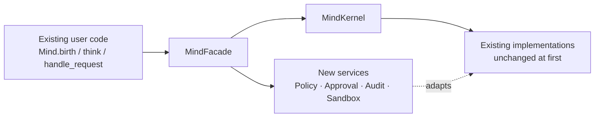

# MIGRATION_STRATEGY.md

> How the existing system becomes V3 **without a big-bang rewrite** and **without losing
> data or breaking the public API**.

---

## 1. Governing constraints

1. Backward compatibility wherever practical (V3 §5.12).
2. Do not silently remove working features (§5.14).
3. Modular monolith before microservices (§5.16).
4. External frameworks behind Genesis-owned interfaces (§5.17).
5. No binding to one agent framework, vector DB, model provider, voice provider, or robot (§5.18).
6. Do not delete the old store until migration validation passes (§45).
7. Migrations must be repeatable, resumable, dry-run capable, backed up, validated,
   count-checked, checksum-checked, auditable, and reversible where practical (§45).

---

## 2. Compatibility strategy: facade-first, adapters-inward

The facade is introduced **before** any internal restructuring. It exposes exactly today's
surface and delegates to today's code. Behaviour is unchanged, so the (red) baseline test
suite stays at the same pass/fail watermark. Only then do internals move behind it.

**Deprecation policy:** warnings only when a signature must change. No forced rewrites.

---

## 3. Phased migration

### Phase A — Baseline & enablement (no behaviour change)
| Step | Deliverable |
|---|---|
| A1 | `docs/v3/*` baseline documents (done, this set) |
| A2 | Fix test determinism: isolate ChromaDB and `~/.genesis` per test via tmp dirs + fixtures |
| A3 | Fix `pyproject.toml`: remove `asyncio`, de-duplicate `pydantic-settings`, reconcile `google-genai`, move heavy vision/browser deps to extras |
| A4 | Fix mypy config (`python_version`) so type checking actually runs |
| A5 | Add lockfile + pin container base image; add `USER` to Dockerfile |
| A6 | Add CI (lint ratchet + tests + migration up/down) and `pre-commit` |
| A7 | Remove `NODE_TLS_REJECT_UNAUTHORIZED=0` |
| A8 | `docs/architecture/adr/` seeded (ADR-0001…ADR-0007) |

**Exit:** suite runs deterministically from a clean clone with one install command; each
pre-existing failure is documented; lint/type ratchets exist.

### Phase B — Security containment vertical slice (the gate)
Order matters; each step is independently testable.

| Step | Change | Backward-compat |
|---|---|---|
| B1 | Add `SandboxProvider` interface + fake provider + container provider | new; nothing depends on it yet |
| B2 | Route `code_executor`, `core/tools`, `plugins/tools` through the provider | same public methods; behaviour now isolated |
| B3 | Remove runtime package installation; return typed `CapabilityUnavailable` | generated code needing a package now fails cleanly |
| B4 | Fix workspace path containment (`core/workspace.py`) | same API; traversal rejected |
| B5 | Fix WebSocket auth (verify before `accept()`; server-derived identity) | clients must pass a token; document the change |
| B6 | Add `PolicyService` (Python rules, R0–R5) | `constitution.validate_*` becomes a thin adapter |
| B7 | Add `ApprovalService` + approval state machine + first approval surface | `REQUIRES_CONFIRMATION` finally satisfiable |
| B8 | Add `AuditService` + event journal + `ActionReceipt` | `actions.jsonl` becomes a projection; keep file for one release |
| B9 | Scrub subprocess environments; add `SecretReference` | providers read secrets via the broker |
| B10 | OTel instrumentation on the turn + execution path | additive |
| B11 | `genesis/evals/` harness + 20 golden scenarios | additive |
| B12 | Security test suite (V3 §6.26 — 19 cases) | additive |

**Exit (Phase B acceptance criteria, from V3 §47-B):** no host filesystem access; no Docker
socket; no network unless allow-listed; no host secret inheritance; resource limits enforced;
timeout enforced; approval scope enforced; receipt generated; **existing public Mind API
preserved**.

### Phase C — Kernel extraction (behaviour-preserving)
Extract in this order, one service per change, each behind the facade:
`IdentityService → MemoryService → AffectService → RelationshipService → GoalService →
PolicyService → CapabilityService → AuditService → CognitionEngine → MindKernel`.

Each extraction: move logic, add interface, keep old import path as a re-export shim, run
tests, confirm identical watermark. **No semantic changes bundled with a move.**

### Phase D — Event journal & checkpoints
Add `events`, `cognitive_checkpoints`, `objective_runs`, `objective_steps` tables.
Backfill: emit synthetic `mind.born` events for existing minds from `minds` rows (ids
preserved). Correlation/causation IDs introduced. Restart recovery test added.

### Phase E — Memory V3
1. Add canonical Postgres/pgvector schema with bi-temporal columns + provenance.
2. Add a **compatibility reader** so `SmartMemoryManager` can read from both stores.
3. Dual-write: canonical store + existing ChromaDB (feature-flagged).
4. Backfill from ChromaDB with count + checksum comparison; dry-run first.
5. Switch reads to the canonical store; keep ChromaDB behind a legacy adapter.
6. Add proposal→validate write pipeline; make `memory_tools` propose instead of mutate.
7. Add user controls (inspect/correct/dispute/restrict/supersede/delete/export) with
   transactional index purge.
8. Optional temporal graph adapter behind `TemporalKnowledgeGraph`; test with it disabled.

**Do not delete ChromaDB data until validation passes.**

### Phase F — Portable identity
Introduce `IdentityManifest` + revisions; generate Ed25519 keypair per Mind; sign a memory
write and a tool call; implement `.genesis` export/import with integrity verification.
Existing `digital_fingerprint` is retained as a display value and marked non-verifiable;
`public_signing_key` is the authority.

### Phase G — Durable governed autonomy
`DurableCognitionRuntime` (LangGraph first adapter, Genesis-owned interface). Objectives with
pause/resume/cancel, approval interrupts, idempotent side effects, budgets, reflection
proposals, and a user-visible objective inspector. **Only one workflow engine per
responsibility.**

### Phase H — Workspace
Projects, notes, artifacts, versioning, indexing, search, provenance, per-item ACLs, and
sandbox snapshots. Workspace is separated from the sandbox: the sandbox receives a scoped
snapshot, never the live workspace root.

### Phase I — MCP & skills
`SkillManifest` (versioned, signed, risk-classified) and the MCP **server**. Existing MCP
client gains a trust model, allow-lists, scoped credentials, schema validation, and
revocation. Marketplace tool installation must route through the skill manifest and policy —
it must not write executable code that is later run ungoverned.

### Phase J — Realtime presence
Provider-neutral voice interfaces with fake implementations first, then a
LiveKit/Pipecat adapter. Consent, visible listening/recording state, temporary vs persistent
sessions, retention controls, and deletion. Voice content passes through the same experience,
memory-proposal, consent, policy, access, and retention paths as text.

### Phase K — Enterprise controls
Tenants + RLS, SSO adapter interface, RBAC/ABAC policy context, audit export, retention,
legal hold, model allow-lists, connector permissions, cost budgets, BYO storage/model
gateway, secret management, admin emergency controls. Explicitly prohibit employee
surveillance, emotion inference, and autonomous performance ratings.

### Phase L — Embodiment
Protocol → fake body → simulator → safety controller → ROS 2 adapter → hardware. Built only
after B–K. The same Mind moves between web, voice, simulation, and robot without becoming a
new identity.

### Phase M — Genesis World
Delegation contracts, discovery, shared projects/workspaces, reputation from verified
outcomes. No inherited permissions, no uncontrolled shared memory, no hidden impersonation.

---

## 4. Data migration tooling

Inputs discovered in Phase A that require migration:

| Source | Location | Target |
|---|---|---|
| Mind identity | `~/.genesis/minds/{gmid}.json` | `minds` + `identity_revisions` + manifest |
| Mind registry rows | SQLite `minds` | Postgres `minds` |
| Memories | ChromaDB `~/.genesis/data/chroma/{mind_id}` | canonical `memories` + pgvector |
| Conversations | SQLite `conversation_messages` | Postgres `conversations` (tenant-scoped) |
| Relationships | SQLite `relationships` | Postgres `relationships` |
| Tasks / background tasks | SQLite `tasks`, `background_tasks` | `objective_runs`/`objective_steps` |
| Concerns / proactive contexts | SQLite `concerns` | `commitments` + journal |
| Thoughts | SQLite `thoughts` | journal events (redacted) |
| GEN balance + ledger | JSON + `gen_transactions` | `budgets` + ledger |
| Access control | SQLite `mind_access`, `global_admins`, `users` | `users`/`tenants`/`permission_grants` (note: `users` should supersede the in-memory store) |
| Workspace files | `~/.genesis/workspaces/{gmid}` | object storage + `workspace_items` |
| Action logs | `~/.genesis/logs/{mind}/actions.jsonl` | event journal (import once) |
| Config | `.env`, settings | `SecretReference` + config |

### Migration tool requirements
Every migrator must support: `--dry-run`, `--resume`, `--validate`, `--report`, idempotency
keys, per-entity counts (source vs destination), content checksums, and a written audit
record. Rollback path documented per migrator. **Old stores are retained read-only until
validation passes.**

### Ordering
`users/tenants → minds/identity → access → conversations → memories → relationships →
goals/tasks → workspace → economy → audit import`

Identity first because every other row carries `mind_id`; tenants before identity because
every row carries `tenant_id` in the target schema.

---

## 5. Rollback strategy

| Phase | Rollback |
|---|---|
| A | Revert config/tooling commits — no data change |
| B | Feature-flag the sandbox provider; keep the old executor callable behind a flag for one release, **but never in production defaults** |
| C | Facade preserves old paths; revert extraction commit |
| D | Journal is additive; drop new tables |
| E | Dual-write means ChromaDB remains authoritative until reads are switched; revert read switch |
| F | Manifest is additive; old fingerprint retained |
| G | Objective runs additive; cancel + revert runtime adapter |
| H–M | Additive services behind flags |

**Non-negotiable:** a rollback must never restore an unsafe default (e.g. re-enabling
runtime `pip install` or unauthenticated WebSocket).

---

## 6. What must NOT happen

- No repository-wide directory move before Phase C tests pass (implement equivalent internal
  module boundaries first; move files later).
- No two workflow engines for the same responsibility.
- No forced DID/blockchain identity.
- No mandatory Temporal in the first migration.
- No microservice extraction before the modular monolith boundary is clean.
- No deletion of the legacy store before validation.
- No mock/fake implementation in production code — fakes are for tests and explicit dev mode
  only.
- No weakening of a security control to make tests pass.

---

## 7. Migration acceptance (definition of done for the first release, V3 §48)

The listed 20-step scenario must pass end-to-end, notably including:
pause → restart → resume **without identity loss**, memory retrieval **with provenance**,
workspace display of identity/memory/goal/artifact/approval/receipt, and
**export → import in a clean environment verifying continuity**.
