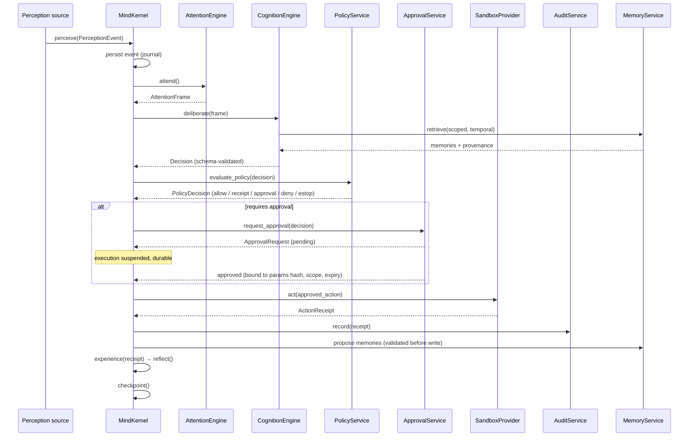
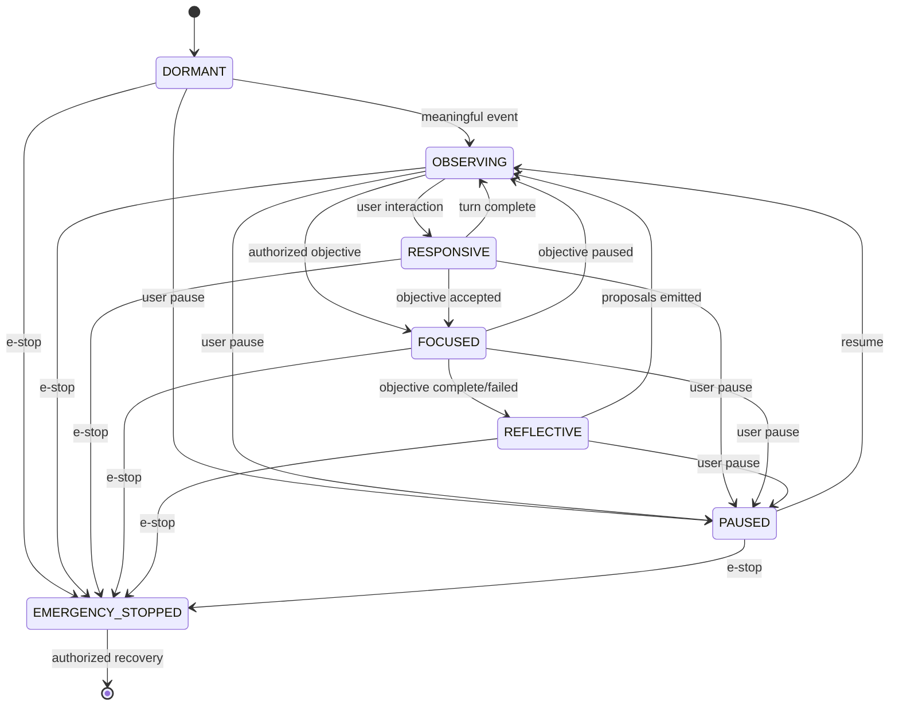
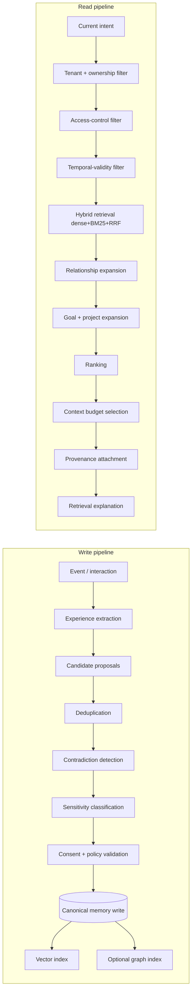
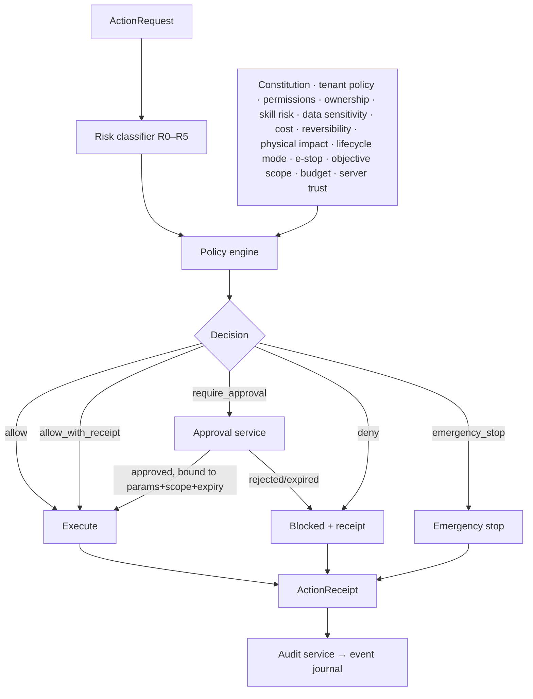
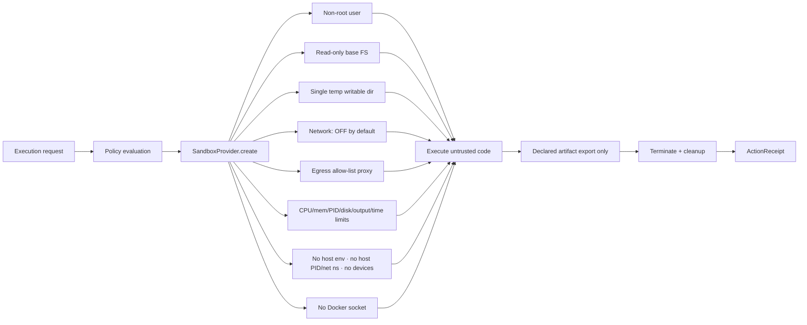

# TARGET_ARCHITECTURE.md — Genesis Minds V3

> Logical architecture for the Digital Beings Operating System. This is a **target**, and
> arrivals are gated by the phases in `IMPLEMENTATION_BACKLOG.md`.
>
> Two rules govern every diagram below:
> 1. **The LLM is not the Mind.** It is a replaceable cognitive component.
> 2. **No side effect happens outside the governance control plane.**

---

## 1. Layer model

```mermaid
flowchart TB
  subgraph EXP["Experience Layer"]
    W[Web · Mind Workspace]
    D[Desktop]
    M[Mobile]
    V[Voice · realtime]
    E[Enterprise integrations]
    X[Developer tools · MCP host]
    R[Robot embodiments]
  end

  subgraph GW["Genesis Gateway"]
    REST[REST API]
    WS[WebSocket]
    RTC[WebRTC / media]
    AUTHN[Authentication]
    AUTHZ[Authorization]
    TENANT[Tenant routing]
    SESS[Session routing]
    RL[Rate limiting]
  end

  subgraph RT["Digital Being Runtime"]
    FAC[MindFacade]
    KER[MindKernel]
    COG[CognitionEngine]
    ATT[AttentionEngine]
    GOAL[GoalEngine]
    CMT[CommitmentEngine]
    REF[ReflectionEngine]
    AFF[AffectEngine]
    REL[RelationshipEngine]
    LIFE[LifecycleEngine]
  end

  subgraph STATE["Cognitive State"]
    ID[Identity]
    CONST[Constitution]
    PER[Persona]
    LS[LifeState]
    MEM[Memory]
    RELS[Relationships]
    GOALS[Goals]
    COMM[Commitments]
    PROJ[Projects]
    EXP2[Experiences]
    TL[Timeline]
    WM[World model]
    PREF[Preferences]
    SK[Skills]
    EMB[Embodiments]
  end

  subgraph ACT["Action & Skills"]
    NS[Native skills]
    MCPT[MCP tools]
    HTTP[HTTP tools]
    BR[Browser tools]
    WST[Workspace tools]
    SBT[Sandbox tools]
    CONN[Connectors]
    HUM[Human approvals]
  end

  subgraph GOV["Governance Control Plane"]
    POL[Policy engine]
    PERM[Permission service]
    CONS[Consent service]
    APPR[Approval service]
    RISK[Risk classifier]
    BUD[Budget service]
    AUD[Audit service]
    ESTOP[Emergency stop]
  end

  subgraph PERS["Persistence"]
    PG[(PostgreSQL canonical)]
    PGV[(pgvector)]
    FTS[(Full-text search)]
    GRAPH[(Optional temporal graph)]
    OBJ[(Object storage)]
    JRN[(Event journal)]
    RDS[(Redis — ephemeral only)]
  end

  subgraph EXEC["Execution"]
    SBP[SandboxProvider]
    CNT[Container sandbox]
    DCR[DurableCognitionRuntime]
    MR[Model router]
    CKPT[Workflow checkpointing]
  end

  subgraph OBS["Observability"]
    OTEL[OpenTelemetry]
    LOGS[Structured logs]
    METR[Metrics]
    COST[Cost records]
    REC[Action receipts]
    EVAL[Evaluation results]
  end

  EXP --> GW --> RT
  RT --> STATE
  RT --> GOV
  GOV --> ACT
  ACT --> EXEC
  GOV --> PERS
  STATE --> PERS
  EXEC --> PERS
  RT --> OBS
  GOV --> OBS
  EXEC --> OBS
```



---

## 2. The kernel turn (perception → action → experience)



**Invariants**
- `deliberate()` output is schema-constrained and rejected if invalid. Invalid model output
  is never executed.
- Every `act()` produces a receipt — including blocked, failed, cancelled, and rolled-back
  attempts.
- `ApprovalService` grants bind to a hash of the exact parameters, a scope, and an expiry.
  Changing a material parameter invalidates the grant.
- Reflection produces **proposals only**; it never mutates constitution, policy,
  permissions, ownership, or audit history.

---

## 3. Cognitive modes (state machine)



| Mode | LLM | Side effects | Notes |
|---|---|---|---|
| `DORMANT` | none | none | heartbeat only |
| `OBSERVING` | none | indexing/classification only | deterministic |
| `RESPONSIVE` | yes | policy-gated | direct user turn |
| `FOCUSED` | yes | policy-gated | authorized objective |
| `REFLECTIVE` | yes | proposals only | consolidation |
| `PAUSED` | per policy | none autonomous | user-initiated |
| `EMERGENCY_STOPPED` | none | none | requires authorized recovery |

Maps from today's `AwarenessLevel(DORMANT, PASSIVE, ALERT, FOCUSED, DEEP)`:
`PASSIVE→OBSERVING`, `ALERT→RESPONSIVE`, `DEEP→REFLECTIVE`; `PAUSED`/`EMERGENCY_STOPPED` are new.

**Heartbeat rule:** the heartbeat checks scheduled commitments, pending approvals, workflow
health, retry eligibility, embodiment status, and budget status — and **must not invoke an
LLM unless meaningful work exists.**

---

## 4. Memory architecture



**Canonical memory record** carries: id, mind, tenant, type, content, normalised claims,
source refs, provenance, confidence, importance, sensitivity, access scope, created,
ingested, valid-from, valid-to, last-verified, retention policy, status, superseded-by,
contradiction refs, embedding ref, graph refs, revision number.

**Temporal rule:** the record distinguishes **when the Mind learned it** (ingestion) from
**when it was true in the world** (validity). This is the difference between today's decay
multiplier and a memory that can survive years.

**Authority rule:** the LLM may *propose* new/corrected/superseding/contradicting/forgotten
memories, relationship updates, and preference updates. A **deterministic application
service** validates and applies them. The LLM never mutates canonical memory directly.

**Memory types:** working, episodic, semantic, procedural, prospective (existing) +
relational, autobiographical, constitutional, organizational, embodiment.

**Degradation rule:** the system must function with the temporal graph disabled.

---

## 5. Governance control plane



### Risk levels
| Level | Meaning | Default disposition |
|---|---|---|
| R0 | read-only public / owner-authorized data | allow |
| R1 | reversible inside the Mind's isolated workspace | allow_with_receipt |
| R2 | modifies a connected external workspace | require_approval |
| R3 | external communication, deploy, purchase, privileged admin | require_approval |
| R4 | legal, medical, financial, employment, safety-critical, physical | require_approval + human |
| R5 | prohibited / destructive / constitutionally disallowed | deny / emergency_stop |

### Policy engine
Deterministic Python rules first (fits the current repo, testable, no new runtime).
OPA/Rego adapter optional for enterprise. **A model-based classifier may advise but is never
the final authority.**

### Approval state machine
`PROPOSED → POLICY_EVALUATED → WAITING_FOR_APPROVAL → APPROVED | REJECTED | EXPIRED →
EXECUTING → COMPLETED | FAILED | ROLLED_BACK`

---

## 6. Sandbox architecture



Providers: local container (first), then gVisor / Kata / Firecracker / managed secure
sandbox behind the same interface. Advanced providers are **not** required for local dev.

**Hard rule:** generated code never executes inside the API, web, cognition, scheduler, or
workflow process.

---

## 7. Identity & portability

```
IdentityManifest {
  global_mind_id, name, creator, owner, guardians,
  birth_record, purpose, values, personality_traits,
  communication_preferences, constitution_ref,
  identity_revisions[], capability_declarations[],
  embodiment_history[], model_history[],
  public_signing_key, content_hashes[], manifest_version
}
```

- Ed25519 signing, verification, rotation, test signer.
- `.genesis` archive: manifest, constitution, revisions, relationships, selected memories +
  metadata, goals, commitments, projects, skill metadata, timeline, embodiment metadata,
  audit export, artifact references.
- `IdentityResolver` interface as the seam for future DID/VC. **W3C DID is not a
  first-stage dependency.**

---

## 8. Model routing

```
ModelRouter.select(task) considers:
  capability · privacy requirement · tenant allowlist · cost budget ·
  latency class · context length · modality · local-vs-remote ·
  data residency · availability · reliability history
```

Deterministic **fake providers** for tests so the entire suite runs without paid keys.
Identity and personality must not change because the provider changed.

---

## 9. Embodiment (Phase L only)

```mermaid
flowchart LR
  SENS[Sensors / simulator] --> ADP[Embodiment adapter]
  ADP --> NPE[Normalized Perception Events]
  NPE --> KER[Mind Kernel]
  KER --> PROP[Proposed Physical Action]
  PROP --> POL[Policy evaluation]
  POL --> HUM[Human approval when required]
  HUM --> SC[Deterministic safety controller]
  SC --> CMD[Bounded robot command]
  CMD --> ACT[Actuators]
```



**The LLM never publishes actuator commands.** The safety controller validates capability,
speed, force, joint limits, collision state, location, restricted zones, human proximity,
battery, emergency stop, command expiry, and approval scope. Physical safety must continue
to function if the LLM, network, Mind service, or cloud is unavailable.

Build order: protocol → fake body → simulator → ROS 2 skeleton → simulation tests → hardware.

---

## 10. Mapping from today's tree

| Target component | Today | Change type |
|---|---|---|
| `MindFacade` | `core/mind.py` `Mind` | wrap (no behaviour change) |
| `MindKernel` | split out of `Mind` + `cognitive_framework.py` | extract |
| `CognitionEngine` | `core/autonomous_reasoner.py`, `intent_classifier.py` | extract |
| `AttentionEngine` | `consciousness_v2.py` `AttentionManager` | rename/extract |
| `AffectEngine` | `core/emotions.py`, `emotional_intelligence.py` | extend (appraisal) |
| `GoalEngine` | `core/goals.py` | move to ORM |
| `CommitmentEngine` | — | new |
| `ReflectionEngine` | — | new |
| `RelationshipEngine` | `core/relationships.py` | wrap |
| `LifecycleEngine` | `core/lifecycle.py` | extend (policies) |
| `MemoryService` | `storage/smart_memory.py` | wrap + new store |
| `PolicyService` | `core/constitution.py` (keyword) | replace |
| `ApprovalService` | — | new |
| `AuditService` | `safety/permissions.py` (JSONL) | replace |
| `SandboxProvider` | `core/code_executor.py` | replace internals, keep facade |
| `DurableCognitionRuntime` | — | new |
| `ModelRouter` | `models/orchestrator.py` | extend |
| `SecretReference` | env vars read directly | new |
| Event journal | — | new |
| OTel | — | new |
| Evals | — | new |

Every one of these is an **extract-and-wrap**, not a rewrite. Existing public API
(`Mind.birth`, `start_living`, `think`, `handle_request`) is preserved via `MindFacade`
throughout.
